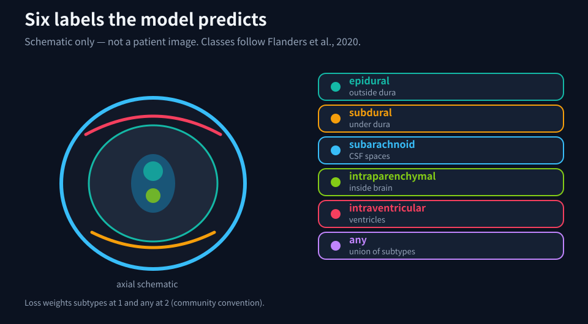
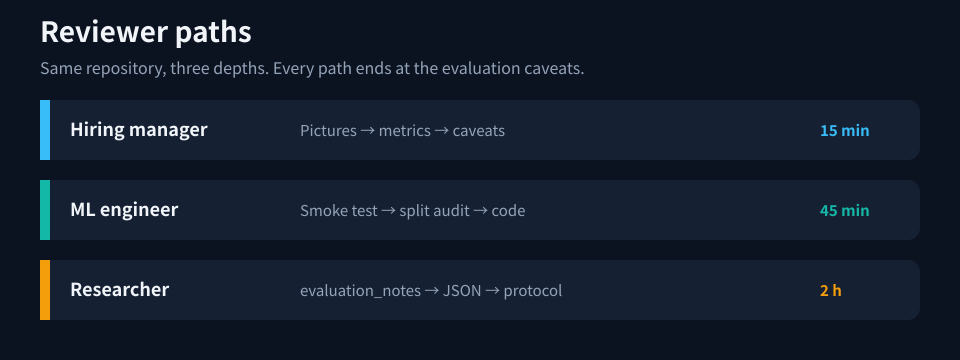
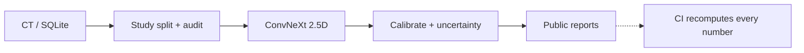
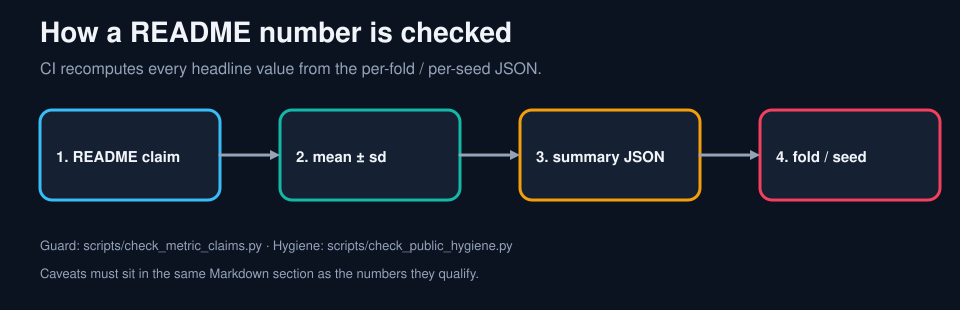
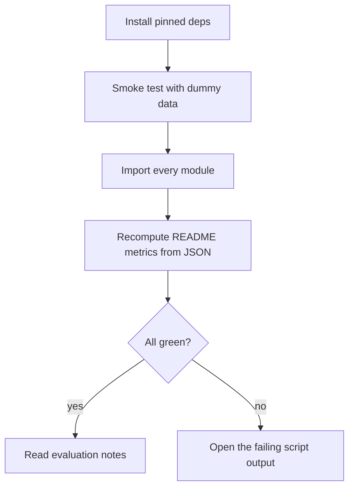
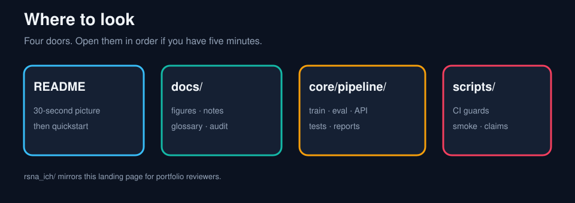
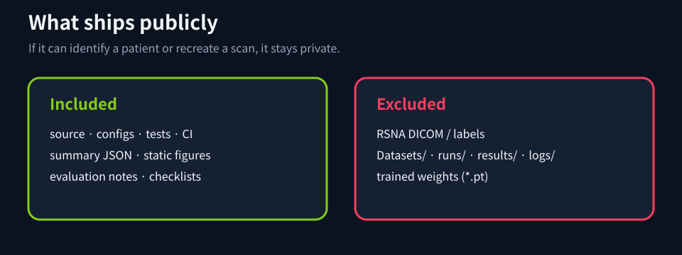

# rsna-ich-reproducible-pipeline

**Language:** English | [Japanese](README_ja.md)

[](https://github.com/yskfuji/rsna-ich-reproducible-pipeline/actions/workflows/ci.yml)

Reproducible intracranial hemorrhage classification for the RSNA ICH challenge — with pictures first, then the numbers, then the caveats.

> Research and portfolio implementation. **Not a medical device.** No patient images ship in this repository.

## Look first (30 seconds)









## Numbers you will see quoted


### Representative results

Mean ± sample standard deviation (ddof=1). The per-fold and per-seed values are in [core/pipeline/reports/rsna_cv_summary.json](core/pipeline/reports/rsna_cv_summary.json), and CI recomputes every number in this table from that file.

| Metric | Value | n | Why it matters |
|---|---:|---:|---|
| Weighted multi-label logloss ↓ | 0.05346 ± 0.00624 | 5 folds | Kaggle competition metric |
| Mean AUC ↑ | 0.98815 ± 0.00311 | 5 folds | Ranking quality across the 6 labels |
| Error-detection AUROC (`any`) ↑ | 0.9424 ± 0.0200 | 10 seeds | How well uncertainty flags wrong predictions |
| ECE (`any`) ↓ | 0.0231 ± 0.0034 | 10 seeds | Probability calibration |


> **Read these numbers together with their evaluation conditions.**
> - Each fold or seed fine-tunes for **1 epoch** on a subsample drawn with `limit_images=8000` (6,852 images remained in the CV run after dropping images missing from the preprocessed store).
> - Every run starts from the same **initial checkpoint**, which was trained on 98% of the studies in the same preprocessed training pool (632,808 of 645,793 slices). Most validation images were therefore probably seen before fine-tuning. Read the values as fine-tuning stability, not as performance on unseen studies.
> - Temperature scaling is fitted on the **same holdout** that is used to report ECE, so calibration metrics are optimistic.
> - Splits group by study, not by patient.
> - This is a research and portfolio implementation, **not a medical device**.
>
> Details and references: [docs/evaluation_notes.md](docs/evaluation_notes.md). Medical images are not included.



## Quickstart without medical data

```bash
pip install --index-url https://download.pytorch.org/whl/cpu torch==2.14.1 torchvision==0.29.1
pip install -r core/pipeline/requirements.txt
python scripts/smoke_test.py --use_dummy_data
python scripts/check_imports.py
python scripts/check_metric_claims.py
```



Full training and evaluation need your own Kaggle download: [core/pipeline/README_en.md](core/pipeline/README_en.md).

## Map of the repository





| Want… | Open… |
|---|---|
| DICOM load / HU / de-dup | [rsna_ich_dataset.py](core/pipeline/src/datasets/rsna_ich_dataset.py) |
| Training + GroupKFold | [train_rsna_cnn2d_classifier.py](core/pipeline/src/training/train_rsna_cnn2d_classifier.py) |
| Split leakage audit | [audit_rsna_split.py](core/pipeline/tools/audit_rsna_split.py) |
| ECE / temperature / AURC | [eval_rsna_uncertainty.py](core/pipeline/tools/eval_rsna_uncertainty.py) |
| Picture-first evaluation notes | [docs/evaluation_notes.md](docs/evaluation_notes.md) |
| Japanese landing page | [README_ja.md](README_ja.md) |
| Portfolio entry folder | [rsna_ich/README_en.md](rsna_ich/README_en.md) |
| Integrity audit | [docs/audit/2026-11-repo-integrity.md](docs/audit/2026-11-repo-integrity.md) |

More: [picture-only index](docs/visual_index.md) · [API demo](docs/api_demo.md) · [reproducibility checklist](docs/reproducibility_checklist.md) · [CITATION.cff](CITATION.cff) · [ROADMAP.md](ROADMAP.md) · [release notes](docs/releases/v0.6.0-rsna.md)

## Regenerate the figures

```bash
python docs/assets/generate_figures.py
```

Figures are SVG (no patient pixels). Metric cards are filled from `rsna_cv_summary.json`.

## Snapshot and citation

Portfolio tag: `v0.6.0-rsna`. Cite via [CITATION.cff](CITATION.cff).

Commits follow Conventional Commits (`fix: …`, `feat: …`, `docs: …`).
