# rsna-ich-reproducible-pipeline

**言語:** 日本語 | [英語版](README.md)

[](https://github.com/yskfuji/rsna-ich-reproducible-pipeline/actions/workflows/ci.yml)

本リポジトリは、RSNA Intracranial Hemorrhage（ICH）Detection Challenge を対象とした、**再現可能な頭蓋内出血の分類パイプライン**を公開する。構成は、図による概観、代表指標、評価上の制約の順とする。

> 本研究実装は研究およびポートフォリオ提示を目的とする。**医療機器ではありません。** 患者画像は公開物に含めない。

## 概観（約30秒）

<p align="center">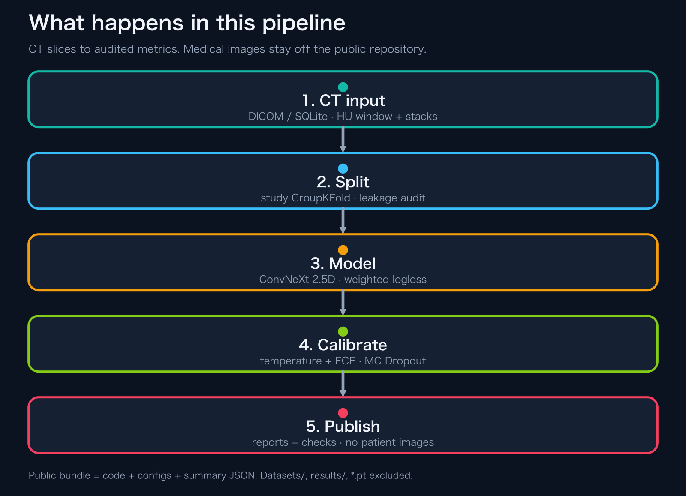</p>

*処理の流れ：CT入力 → 検査単位分割 → ConvNeXt → 校正および不確実性評価 → 公開レポート*

<p align="center">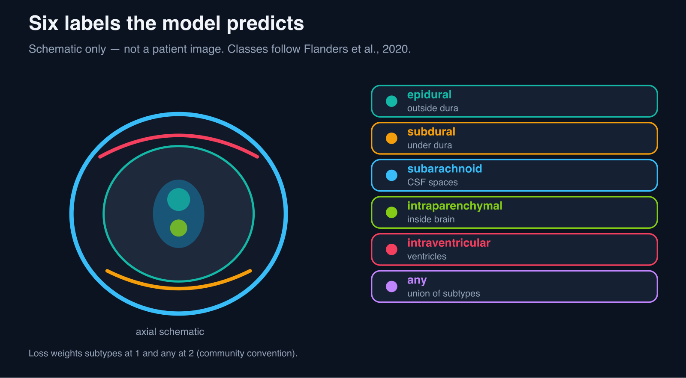</p>

*硬膜外・硬膜下・くも膜下・脳実質内・脳室内、ならびにいずれかの出血の有無を示す `any`。図は模式図であり、実画像ではない。*

<p align="center">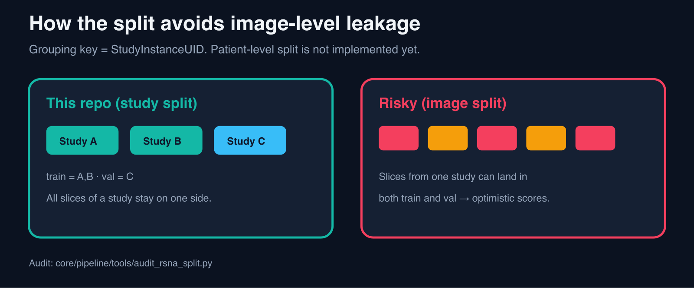</p>

*左は本リポジトリが採用する検査単位分割。右は画像単位分割に伴い生じうる情報リークの模式である。*

<p align="center">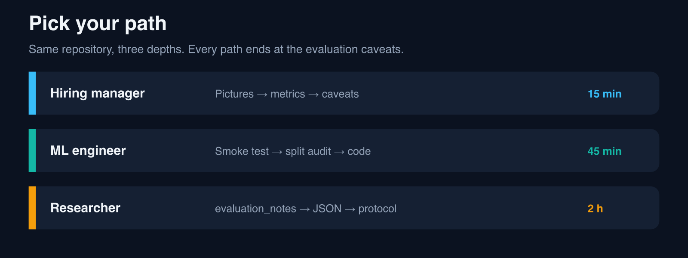</p>

*採用審査、機械学習実装、研究再現の三経路。いずれの経路も評価上の制約の確認に帰着する。*

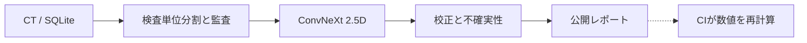

## 代表指標

<p align="center">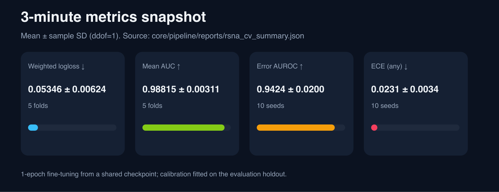</p>

<p align="center">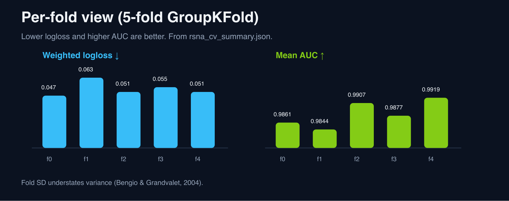</p>

<p align="center">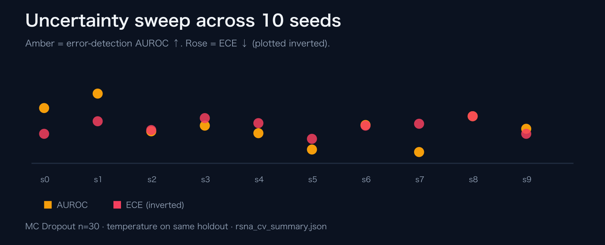</p>

### 数値の要約

表記は「平均 ± 標本標準偏差（ddof=1）」とする。fold別およびシード別の値は [core/pipeline/reports/rsna_cv_summary.json](core/pipeline/reports/rsna_cv_summary.json) に収録し、本表の数値は継続的統合（CI）が同ファイルから再計算して照合する。

| 指標 | 値 | n | 解釈 |
|---|---:|---:|---|
| 加重マルチラベル対数損失（低いほど良い） | 0.05346 ± 0.00624 | 5 fold | Kaggleコンペティションの評価指標 |
| 平均AUC（高いほど良い） | 0.98815 ± 0.00311 | 5 fold | 6ラベルを通した順位付けの性能 |
| 誤り検出AUROC（`any`、高いほど良い） | 0.9424 ± 0.0200 | 10シード | 不確実性で誤った予測をどれだけ見分けられるか |
| ECE（`any`、低いほど良い） | 0.0231 ± 0.0034 | 10シード | 予測確率の校正の良さ |

<p align="center">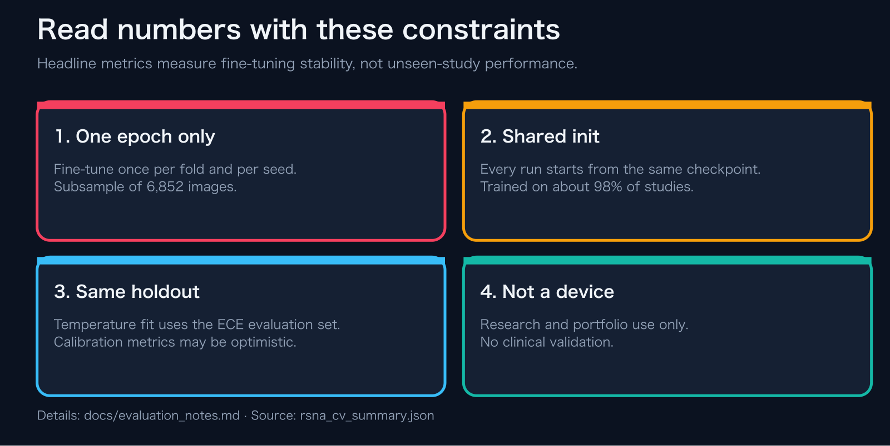</p>

> **数値は、次の評価条件とあわせて解釈すること。**
> - 各foldと各シードは、`limit_images=8000` で抽出したデータ（交差検証では、前処理済みデータにない画像を除いた6,852枚）で**1エポック**だけ追加学習している。
> - すべての実行は同じ**初期重み**から開始する。この初期重みは、同じ前処理済みの学習データの98%の検査（645,793スライスのうち632,808スライス）で学習済みである。したがって検証画像の多くは追加学習前に既に学習されていたと推定される。数値は追加学習の安定性を示すものであり、未知の検査に対する性能ではない。
> - 温度スケーリングは、ECEの評価と**同じ検証データ**で推定している。このため校正指標は楽観的に偏りうる。
> - 分割は検査単位であり、患者単位ではない。
> - 研究およびポートフォリオのための実装であり、**医療機器ではありません**。
>
> 詳細な条件および参考文献は [docs/evaluation_notes_ja.md](docs/evaluation_notes_ja.md) を参照する。医用画像は公開物に含めない。

<p align="center">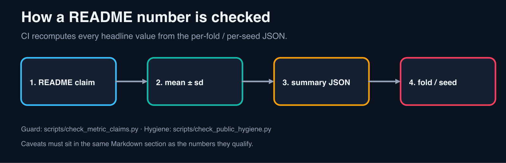</p>

用語の対応は [用語集](docs/glossary_ja.md) を参照する。

## 医療データを用いず動作を確認する手順

```bash
pip install --index-url https://download.pytorch.org/whl/cpu torch==2.14.1 torchvision==0.29.1
pip install -r core/pipeline/requirements.txt
python scripts/smoke_test.py --use_dummy_data
python scripts/check_imports.py
python scripts/check_metric_claims.py
```

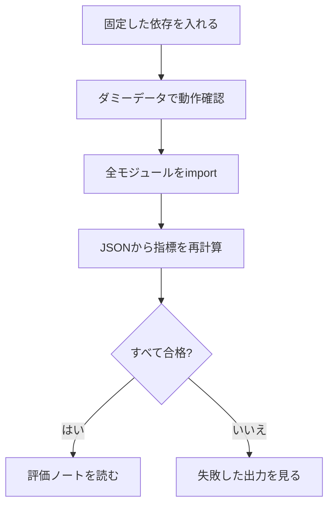

実データによる学習および評価手順は [core/pipeline/README.md](core/pipeline/README.md) に記す。

## リポジトリ構成

<p align="center">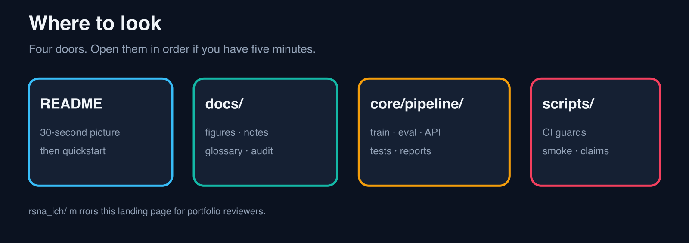</p>

<p align="center">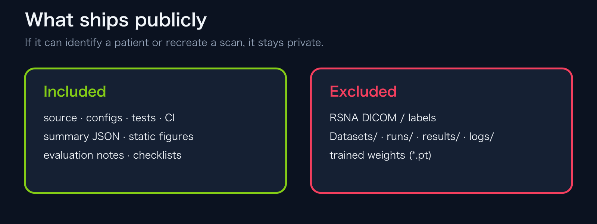</p>

| 確認事項 | 参照先 |
|---|---|
| DICOM読込み、HU窓処理、重複除去 | [rsna_ich_dataset.py](core/pipeline/src/datasets/rsna_ich_dataset.py) |
| 学習およびGroupKFold | [train_rsna_cnn2d_classifier.py](core/pipeline/src/training/train_rsna_cnn2d_classifier.py) |
| 分割におけるリーク監査 | [audit_rsna_split.py](core/pipeline/tools/audit_rsna_split.py) |
| ECE・温度スケーリング・AURC | [eval_rsna_uncertainty.py](core/pipeline/tools/eval_rsna_uncertainty.py) |
| 図付き評価ノート | [docs/evaluation_notes_ja.md](docs/evaluation_notes_ja.md) |
| 英語版入口 | [README.md](README.md) |
| ポートフォリオ向け入口 | [rsna_ich/README.md](rsna_ich/README.md) |
| 整合性の監査記録 | [docs/audit/2026-11-repo-integrity.md](docs/audit/2026-11-repo-integrity.md) |

関連資料：[図索引](docs/visual_index_ja.md) · [APIデモ](docs/api_demo_ja.md) · [再現性チェックリスト](docs/reproducibility_checklist_ja.md) · [CITATION.cff](CITATION.cff) · [ROADMAP.md](ROADMAP.md) · [リリースノート](docs/releases/v0.6.0-rsna_ja.md)

## 図の再生成

```bash
python docs/assets/generate_figures.py
```

図はSVGであり、患者画素を含まない。指標カードの数値は `rsna_cv_summary.json` から埋め込む。

## スナップショットおよび引用

ポートフォリオ用固定タグは `v0.6.0-rsna` である。引用は [CITATION.cff](CITATION.cff) に従う。

コミットメッセージは Conventional Commits（`fix: …`、`feat: …`、`docs: …`）に統一する。
