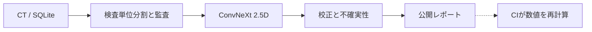
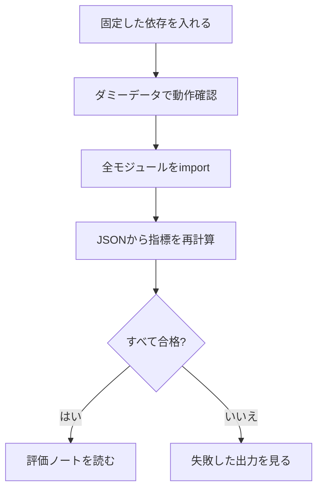

# rsna-ich-reproducible-pipeline

**言語:** 日本語 | [英語版](README.md)

[](https://github.com/yskfuji/rsna-ich-reproducible-pipeline/actions/workflows/ci.yml)

RSNA ICH challenge 向けの、**再現可能な頭蓋内出血の分類パイプライン**です。まず図で全体をつかみ、次に数値、最後に制約を読む構成にしています。

> 研究とポートフォリオのための実装です。**医療機器ではありません。** 患者の画像は公開物に含めていません。

## まず絵で見る（30秒）


*上から順に：CT入力 → 検査単位の分割 → ConvNeXt → 校正と不確実性 → 公開レポート*


*硬膜外・硬膜下・くも膜下・脳実質内・脳室内、およびいずれかがあることを示す `any`。図は模式図であり、実画像ではありません。*


*左がこのリポジトリの検査単位分割。右は画像単位だと起きうる危険な分割です。*


*採用担当・MLエンジニア・研究者の3つの深さ。どのコースも最後は評価の制約に着地します。*



## 引用されやすい数値


### 代表指標

表記は「平均 ± 標本標準偏差（ddof=1）」です。fold別・シード別の値は [core/pipeline/reports/rsna_cv_summary.json](core/pipeline/reports/rsna_cv_summary.json) にあり、この表の数値はすべてCIがこのファイルから計算し直して照合しています。

| 指標 | 値 | n | 意味 |
|---|---:|---:|---|
| 加重マルチラベル対数損失（低いほど良い） | 0.05346 ± 0.00624 | 5 fold | Kaggleコンペティションの評価指標 |
| 平均AUC（高いほど良い） | 0.98815 ± 0.00311 | 5 fold | 6ラベルを通した順位付けの性能 |
| 誤り検出AUROC（`any`、高いほど良い） | 0.9424 ± 0.0200 | 10シード | 不確実性で誤った予測をどれだけ見分けられるか |
| ECE（`any`、低いほど良い） | 0.0231 ± 0.0034 | 10シード | 予測確率の校正の良さ |


> **数値は、次の評価条件とあわせて読んでください。**
> - 各foldと各シードは、`limit_images=8000` で抽出したデータ（交差検証では、前処理済みデータにない画像を除いた6,852枚）で**1エポック**だけ追加学習しています。
> - すべての実行は同じ**初期重み**から始めています。この初期重みは、同じ前処理済みの学習データの98%の検査（645,793スライスのうち632,808スライス）で学習済みです。そのため、検証画像の多くは追加学習の前にすでに学習されていたと考えられます。数値は追加学習の安定性を示すもので、未知の検査に対する性能ではありません。
> - 温度スケーリングは、ECEの評価と**同じ検証データ**で推定しています。そのため、校正の指標は楽観的に出ます。
> - 分割は検査単位で、患者単位ではありません。
> - 研究とポートフォリオのための実装で、**医療機器ではありません**。
>
> 詳しい条件と参考文献は [docs/evaluation_notes_ja.md](docs/evaluation_notes_ja.md) にあります。医用画像は公開物に含めていません。


用語がわからないときは [用語集](docs/glossary_ja.md) を開いてください。

## 実データなしで確かめる

```bash
pip install --index-url https://download.pytorch.org/whl/cpu torch==2.14.1 torchvision==0.29.1
pip install -r core/pipeline/requirements.txt
python scripts/smoke_test.py --use_dummy_data
python scripts/check_imports.py
python scripts/check_metric_claims.py
```



実データでの学習と評価は [core/pipeline/README.md](core/pipeline/README.md) にあります。

## 地図


| 見たいこと | 場所 |
|---|---|
| DICOMの読み込み、HU、重複除去 | [rsna_ich_dataset.py](core/pipeline/src/datasets/rsna_ich_dataset.py) |
| 学習とGroupKFold | [train_rsna_cnn2d_classifier.py](core/pipeline/src/training/train_rsna_cnn2d_classifier.py) |
| 分割のリーク監査 | [audit_rsna_split.py](core/pipeline/tools/audit_rsna_split.py) |
| ECE・温度・AURC | [eval_rsna_uncertainty.py](core/pipeline/tools/eval_rsna_uncertainty.py) |
| 図付きの評価ノート | [docs/evaluation_notes_ja.md](docs/evaluation_notes_ja.md) |
| 英語の入口 | [README.md](README.md) |
| ポートフォリオ用の入口 | [rsna_ich/README.md](rsna_ich/README.md) |
| 整合性の監査記録 | [docs/audit/2026-11-repo-integrity.md](docs/audit/2026-11-repo-integrity.md) |

ほか: [図だけの索引](docs/visual_index_ja.md) · [APIデモ](docs/api_demo_ja.md) · [再現性チェックリスト](docs/reproducibility_checklist_ja.md) · [CITATION.cff](CITATION.cff) · [ROADMAP.md](ROADMAP.md) · [リリースノート](docs/releases/v0.6.0-rsna_ja.md)

## 図の再生成

```bash
python docs/assets/generate_figures.py
```

図はSVGです（患者の画素は含みません）。指標カードの数値は `rsna_cv_summary.json` から埋めます。

## スナップショットと引用

ポートフォリオ用のタグは `v0.6.0-rsna` です。引用は [CITATION.cff](CITATION.cff) を使ってください。

コミットメッセージは Conventional Commits（`fix: …`、`feat: …`、`docs: …`）に揃えます。
