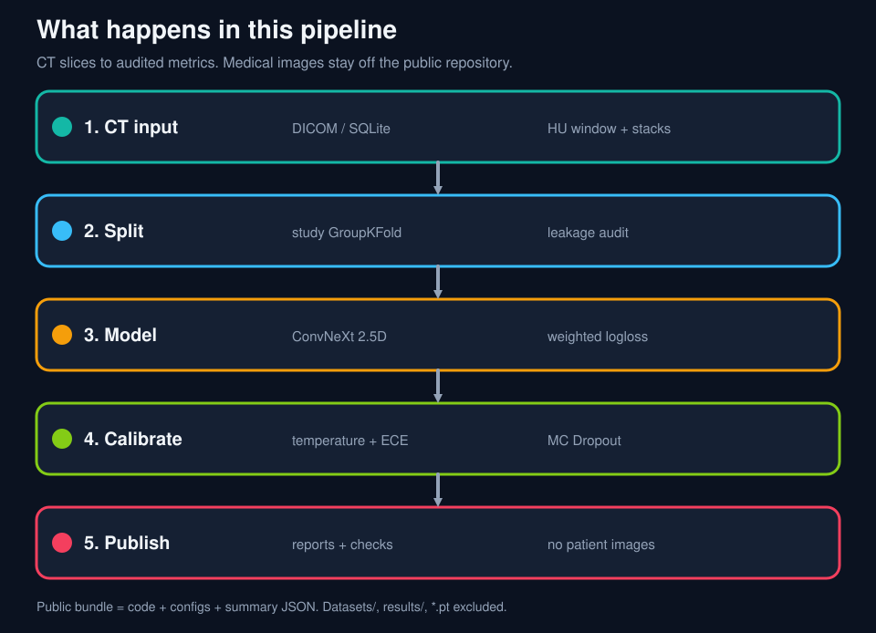
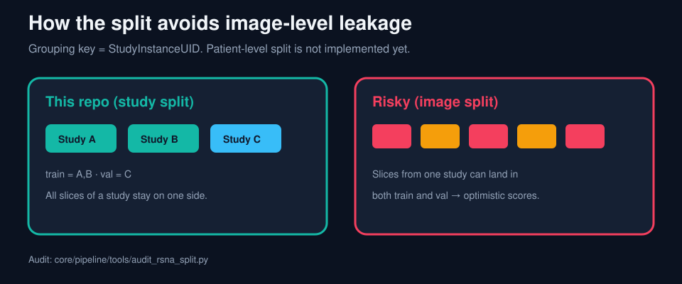
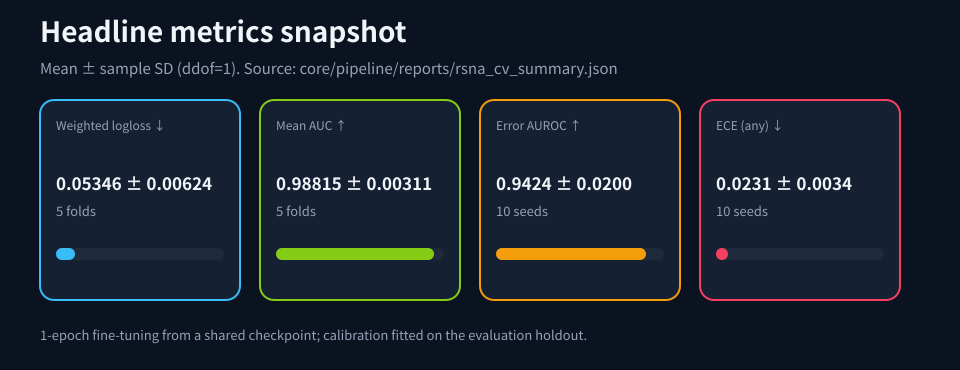
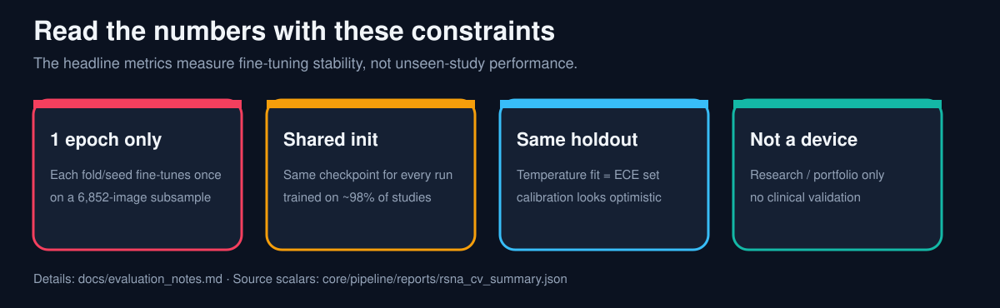
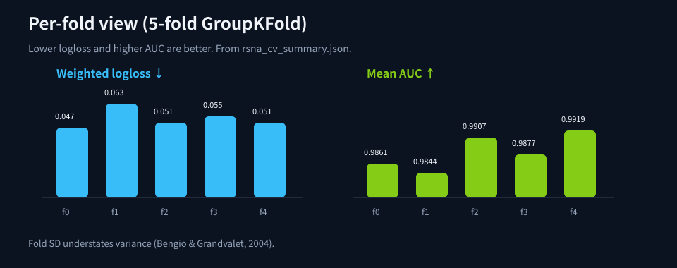
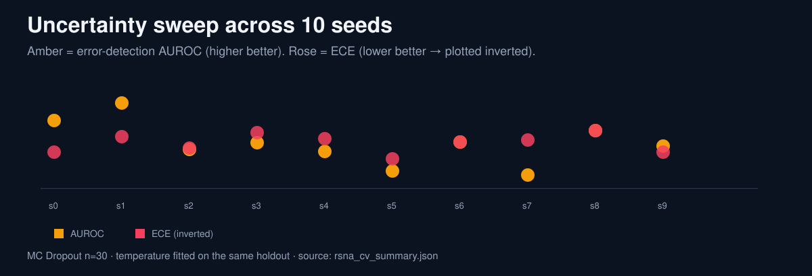

# RSNA Intracranial Hemorrhage (Kaggle 2019) — Auditable, Reproducible Experiment README (Portfolio)

**Language:** English | [Japanese](README.md)

## Current Portfolio Snapshot

The current portfolio snapshot corresponds to:

✅ v0.6.0-rsna

Active development continues in the repository.

This folder (pipeline/) is a minimal pipeline to run RSNA ICH training/evaluation/inference in an **auditable, reproducible** way.
To help reviewers decide quickly, this README starts with **reproducibility, split design (leakage prevention), comparison axes, and ablation results**.

## Look at the pictures first













Picture-first landing page: [../../README.md](../../README.md)

---

## TL;DR (what you can verify here)

> **Evaluation boundary (read first).** All headline numbers are mean ± sample standard deviation (ddof=1) recomputed in CI from [`reports/rsna_cv_summary.json`](reports/rsna_cv_summary.json).
> - Each CV fold and each uncertainty seed fine-tunes for **1 epoch** on a subsample drawn with `limit_images=8000` (6,852 images remained in the CV run after dropping images missing from the preprocessed store).
> - Every run starts from the same **initial checkpoint** (`rsna_convnext25d_final2_full_mps_nosamp_nopw_20260202_222608/best.pt`), trained for 6 epochs on 98% of the studies in the preprocessed training pool (645,793 slices). About 98% of each validation fold is therefore expected to have been training data for that checkpoint (expected value, not measured). The numbers show fine-tuning stability, not performance on unseen studies.
> - Temperature scaling is fitted on the **same holdout** used to report ECE, Brier and AURC.
> - Splits group by study; patient-level grouping is not implemented.
> - This is a research and portfolio implementation, **not a medical device**.
>
> Full list of limitations and references: [../../docs/evaluation_notes.md](../../docs/evaluation_notes.md)

- Reproducibility (this bundle): supported by recorded artifacts (`meta.json` / `log.jsonl`, including `split_stats`) and fixed CLI commands (e.g., `results/rsna_convnext25d_ft_repro_val05_short_20260210_101836_run1` and `_run2`).
- Source commit (upstream, reference): `9bc2684fe0b564c792025b52694f9c4fe1a0d32d` (commit id of the upstream repository at the time this code snapshot was exported).
- Source repo URL: the upstream research repository is private. Changes to this exported snapshot are traced by the Git history of this public repository.
- Distribution integrity (optional): generate a file manifest (paths + sha256) via `python tools/make_manifest.py` (e.g., `--out MANIFEST.sha256`) to fingerprint this bundle.

- **Robustness ("was it just luck?")**: Study-level **GroupKFold(5)** with `split_by=study` yields `val_logloss_weighted = 0.05346 ± 0.00624` (`epochs=1` / `kept=6852`, fast CV).
- **Reproducibility**: two runs with identical seed/args reproduce `split_stats` and `val_*` (observed exact match: `abs_diff=0` in this environment; generally verify with `abs_diff <= 1e-6` depending on backend).
- **Leakage-safe evaluation**: use a study-level **group split** (`split_by=study`) so the same Study never spans train/val.
- **Practical value**: audit scripts mechanically verify that train/val group intersection is 0.
- **Leakage audit status (2026-02-14)**: across 10 seeds, Study/Series intersections are 0, and with **pre-split tensor-hash dedup (default ON)**, exact-duplicate hash intersection between train/val is also 0.
- **Primary metric**: Kaggle-style weighted multi-label logloss (`val_logloss_weighted`); AUC is auxiliary.
- **Uncertainty and calibration (10 seeds, `split_by=study`, dedup enabled, retrained with dropout)**:
  - Error-detection AUROC(any): **0.9424 ± 0.0200**
  - ECE(any): **0.0231 ± 0.0034**
  - Brier(any): **0.0209 ± 0.0057**
  - AURC(weighted logloss): **0.00837 ± 0.00225**
  - coverage=0.8 accuracy(any) gain: **+2.53 ± 0.94 pp** (the baseline arm gains +2.98 pp under the same protocol)
  - vs. baseline (same protocol): ECE **-0.0091**, Brier **-0.0040**, AURC **-0.00139**, AUROC **+0.0046**
  - The AUROC difference is within noise: paired by seed, it improved in only 5 of 10 seeds.
- **Temperature-scaling boundary (important)**: the uncertainty numbers in this README come from running `--fit-temperature` on the same holdout validation split used for evaluation (fit set = eval set), so ECE/Brier may look optimistic. For strict reporting, use a calib/eval split or a separate evaluation holdout.
- **Audit hook (subset identity)**: in addition to `split_stats` consistency, record sorted `image_id` SHA256 as `subset_fingerprint_sha256` in **`meta.json` (implemented)**. `tools/eval_rsna_uncertainty.py` also outputs `adopted_subset_fingerprint_sha256` / `val_subset_fingerprint_sha256` in its JSON.
  - `subset_fingerprint_sha256` definition: sort adopted `image_id` ascending, join with `\n`, take SHA256 of the UTF-8 string (hex)
  - `adopted_subset_*` is the full adopted subset after `limit_images` etc; `val_subset_*` is the `image_id` subset that ended up in validation
- **Public API demo**: `serve_rsna_ich_api.py` exposes a small FastAPI schema for portfolio review and future MLflow/API integration.

## 0. Reviewer benchmark table

| Evaluation slice | Protocol | Primary result | Secondary result | Why it matters |
|---|---|---|---|---|
| Robustness | GroupKFold(5), `split_by=study`, `epochs=1`, `kept=6852` | weighted logloss `0.05346 ± 0.00624` | mean AUC `0.98815 ± 0.00311` | Shows the signal survives fold changes rather than a single lucky holdout |
| Reproducibility | holdout `val_frac=0.05`, same seed/args run twice | weighted logloss `0.0555525` | mean AUC `0.9915841`, `abs_diff=0` for recorded `val_*` metrics in this environment | Demonstrates the exported recipe can be rerun deterministically |
| Uncertainty / calibration | 10 seeds, `split_by=study`, de-dup enabled, dropout retrain | error-detection AUROC(any) `0.9424 ± 0.0200` | ECE(any) `0.0231 ± 0.0034`, Brier(any) `0.0209 ± 0.0057`, coverage=0.8 accuracy gain `+2.53 ± 0.94 pp` | Shows the probabilities are useful beyond raw classification accuracy |

- Quick reproduce (holdout, 1 epoch):

```bash
# Quick reproduce (holdout, 1 epoch)
TORCH_DEVICE=mps python train_rsna_cnn2d_classifier.py train --rsna-root ... --preprocessed-root ... --out-dir results/repro_demo --limit-images 8000 --val-frac 0.05 --split-by study --seed 0 --epochs 1 --num-workers 0 --no-aug --no-scheduler --arch convnext_tiny --pretrained --init-from "results/rsna_convnext25d_final2_full_mps_nosamp_nopw_20260202_222608/best.pt"

# If --init-from is unavailable:
# - omit it (ImageNet-pretrained only), or
# - set it to results/**/best*.pt
```

  → outputs: `meta.json`, `log.jsonl`, checkpoints under `results/repro_demo/` (see §2.2 for the full command).
  For concrete paths, see §2.1 Data example (rsna_root / preprocessed_root).

- API demo surface:

```bash
cd pipeline
python serve_rsna_ich_api.py
```

  If port `8000` is already in use, run `API_PORT=8011 python serve_rsna_ich_api.py` instead.

  Open `http://127.0.0.1:8000/docs` to inspect `/health`, `/v1/models/{alias_or_version}`, and `/v1/infer/ich_classification`.

- Model registration stage:

```bash
python tools/register_model.py \
  --run-dir results/<YOUR_RUN_DIR> \
  --model-name rsna-convnext25d \
  --version-label candidate-logloss \
  --checkpoint best_wlogloss.pt \
  --selection-reason "lowest validation weighted logloss" \
  --promotion-rule "val_logloss_weighted<=0.055"
```

  This creates `artifacts/registered_models/<model-name>/<version-label>/` with `registration.json`, `run_metadata/`, `training_trace/`, and `checkpoints/`.

  Optional MLflow handoff:

```bash
python tools/register_model.py \
  --run-dir results/<YOUR_RUN_DIR> \
  --model-name rsna-convnext25d \
  --version-label candidate-logloss \
  --checkpoint best_wlogloss.pt \
  --promotion-rule "val_logloss_weighted<=0.055" \
  --mlflow-register \
  --mlflow-experiment rsna-model-registration \
  --registered-model-name rsna-convnext25d \
  --promote-alias candidate \
  --reject-alias needs-review
```

Promotion criteria are evaluated against the latest metrics in `log.jsonl`. If the condition passes, the configured alias is updated on the created MLflow model version.

To verify the full handoff in one command, use `verify_registration.py`.

```bash
python tools/verify_registration.py \
  --run-dir results/<YOUR_RUN_DIR> \
  --model-name rsna-convnext25d \
  --version-label verify-candidate-logloss \
  --checkpoint best_wlogloss.pt \
  --promotion-rule "val_logloss_weighted<=0.055" \
  --registered-model-name rsna-convnext25d-verify
```

This verification wrapper creates a local SQLite-backed MLflow Registry under `artifacts/verification/`, runs `register_model.py`, and prints a compact JSON summary covering both `registration.json` and the expected alias.

---

## 1. Metric Summary (this report)

### 1.1 Robustness check via GroupKFold(5) CV (study-level)

To address the concern “validation might be too small and lucky”, we run **GroupKFold(5)** with `split_by=study` (StudyInstanceUID).

Settings (fast CV):
- `limit_images=8000` (after excluding missing keys in the preprocessed DB: `kept=6852`)
- `epochs=1` (direction-check fast CV)
- `init_from=best.pt` (fine-tune)
  - `best.pt` was saved on validation in another run (see §2.2). It was not selected based on this CV’s validation.

Rough denominators (val-side; mean±std across folds):
- `n_val_studies = 1178.0 ± 1.0`
- `n_val_images = 1370.4 ± 9.6`
- `pos_rate_any = 0.1496 ± 0.0030`

CV results (val):
- `val_logloss_weighted`: **0.05346 ± 0.00624** (min 0.04732 / max 0.06347)
- `val_auc_mean`: **0.98815 ± 0.00311** (min 0.98441 / max 0.99188)

Note: all scores above are computed with `enforce_any_max=True` (default) applied after sigmoid (see §5.1 for details).

Aggregation (reproducible definition):
- Extract `val_logloss_weighted` / `val_auc_mean` from the **last line** of each fold’s `log.jsonl`, then compute mean±std (and min/max) across folds. Throughout this README, "std" is the sample standard deviation (ddof=1, `statistics.stdev`).
- Use `tools/summarize_cv.py` to aggregate automatically (see §2.3).

Run directory:
- `results/rsna_convnext25d_ft_gkfold5_e1_lim8k_20260210_150447`

---

### 1.2 Bridging fast CV to longer training (learning curve on a representative fold)

Fast CV (`epochs=1`) still leaves the question “what happens if we train longer?”
As a representative example, we run fold0 with `epochs=5` and report the learning curve.

Run:
- `results/rsna_convnext25d_ft_gkfold5_fold0_epochs5_20260210_160037`

| epoch | val_logloss_weighted | val_auc_mean | val_loss_plain |
|---:|---:|---:|---:|
| 1 | 0.04732 | 0.98608 | 0.04313 |
| 2 | 0.04639 | 0.98695 | 0.04235 |
| 3 | 0.04629 | 0.98777 | 0.04230 |
| 4 | 0.04672 | 0.98843 | 0.04264 |
| 5 | 0.04772 | 0.98839 | 0.04368 |

Note:
- In this fold, the best `val_logloss_weighted` occurs at **epoch=3 (0.04629)**; later epochs worsen, so an early-stop style decision is reasonable.

---

### 1.3 Single holdout (val_frac=0.05) and reproducibility (run1 vs run2)

Runs:
- `results/rsna_convnext25d_ft_repro_val05_short_20260210_101836_run1`
- `results/rsna_convnext25d_ft_repro_val05_short_20260210_111323_run2`

Key metrics (val):
- `val_logloss_weighted = 0.0555525` (with `enforce_any_max=True`)
- `val_auc_mean = 0.9915841`

Reproducibility outcome:
- With identical seed/args, `split_stats` and `val_*` match **exactly (abs_diff=0)**.
  - Exact equality may depend on the backend/kernels; generally, verifying `abs_diff <= 1e-6` is safer.
  - On CPU/CUDA, enabling `--num-workers > 0` or AMP may break exact equality (≠ “not reproducible”).

---

### 1.4 Seed sweep (0/1/2): mean±std

Under the same settings (`val_frac=0.05`, `split_by=study`, `limit_images=8000`, `epochs=1`), we ran three seeds.

| seed | val_logloss_weighted | val_auc_mean |
|---:|---:|---:|
| 0 | 0.0555525 | 0.9915841 |
| 1 | 0.0461215 | 0.9943803 |
| 2 | 0.0600081 | 0.9808989 |
| mean ± std | 0.0538940 ± 0.0070903 | 0.9889545 ± 0.0071150 |

Notes:
- This is **validation**, not Kaggle Private LB.
- AUC measures ranking/separation; logloss measures probability calibration/fit; they may not move together.

---

## 2. How to Reproduce (one command)

### 2.1 Prerequisites

- Assumes macOS + `mps` (designed to also run on CPU/CUDA)
- Examples use a **preprocessed SQLite** (fast; does not depend on having DICOMs)

Recommended settings for stronger reproducibility:
- `--num-workers 0`, `--no-aug`
- fix `--seed` and keep the inputs (CSV/SQLite) identical
- expected reproducibility check: meta.json.split_stats matches AND abs_diff <= 1e-6 for val_* (exact equality may still depend on backend/kernels)

Pass criteria (reproducibility, recommended):
1. meta.json.split_stats matches
2. abs_diff <= 1e-6 (recommended) for all of: `val_loss`, `val_loss_plain`, `val_auc_mean`, `val_logloss_weighted`
3. audit_rsna_split.py reports n_group_intersection == 0 AND n_imageid_intersection == 0
4. `subset_fingerprint_sha256` matches (optional but recommended)

Tested environment (this report):
- Python 3.12.4
- PyTorch 2.6.0 / torchvision 0.21.0
  - Note: `requirements.txt` pins PyTorch 2.14.1 / torchvision 0.29.1 to avoid known vulnerabilities in 2.6.0. A different version may not meet the `abs_diff <= 1e-6` criterion above. To reproduce with the recorded version, use an isolated environment without network access.
- timm: not used (`convnext_tiny` is `torchvision.models.convnext_tiny`)
- device: `mps`
- matmul precision: in these runs `torch.get_float32_matmul_precision() == "highest"` (default)
  - This can vary by PyTorch version/backend; set `torch.set_float32_matmul_precision("highest")` explicitly if needed.

Reproducibility note on `--limit-images`:
- When `--limit-images` is used, the subset selection is implemented to be stable given the same `--seed` and identical inputs (CSV + preprocessed DB).
- You can audit subset+split identity via `meta.json.split_stats` (it records `limit_images`, `seed`, and `split_stats`).

Preprocessing fit boundary (explicit, to avoid leakage suspicion):
- `--windows` (HU window) and `--stack-slices` are **fixed transforms**; they do not fit statistics from train/val.
- In this README’s settings, `--input-normalize none`, so no dataset mean/std is fitted.
- The preprocessed SQLite stores transformed images and metadata (Study/Series UID etc.); it does not depend on labels or splits.

Data example (used in these runs):
- `rsna_root`: `pipeline/Datasets/rsna_preprocessed_gpt52_img384_w3_f32/rsna_meta`
- `preprocessed_root`: `pipeline/Datasets/rsna_preprocessed_gpt52_img384_w3_f32`

---

### 2.2 Command (fine-tune short / val_frac=0.05)

Entry point:
- `train_rsna_cnn2d_classifier.py` (thin wrapper in this folder)
  - implementation: `src/training/train_rsna_cnn2d_classifier.py` (Typer app)

```bash
cd pipeline

TORCH_DEVICE=mps python train_rsna_cnn2d_classifier.py train \
  --rsna-root "Datasets/rsna_preprocessed_gpt52_img384_w3_f32/rsna_meta" \
  --preprocessed-root "Datasets/rsna_preprocessed_gpt52_img384_w3_f32" \
  --out-dir "results/<YOUR_RUN_DIR>" \
  --limit-images 8000 \
  --val-frac 0.05 \
  --split-by study \
  --seed 0 \
  --epochs 1 \
  --lr 5e-06 \
  --weight-decay 0.0 \
  --image-size 384 \
  --windows '40,80;80,200;600,2800' \
  --preprocess gpt52 \
  --stack-slices 3 \
  --batch-size 6 \
  --num-workers 0 \
  --arch convnext_tiny \
  --pretrained \
  --first-conv-init mean \
  --input-normalize none \
  --no-aug \
  --no-scheduler \
  --loss-any-weight 1.0 \
  --no-use-pos-weight \
  --no-use-sampler \
  --optimize-plain-loss \
  --init-from "results/rsna_convnext25d_final2_full_mps_nosamp_nopw_20260202_222608/best.pt" \
  --log-every-steps 200
```

Where `init_from` comes from:
- `results/rsna_convnext25d_final2_full_mps_nosamp_nopw_20260202_222608/best.pt`
  - A checkpoint saved as **minimum `val_loss`** on holdout validation (`split_by=study`, `val_frac=0.02`) in another run.
  - Its selection did not use this report’s evaluation results.
  - **Its training data are not independent of this README’s validation folds.** It was trained on 632,808 slices (98% of the studies in the 645,793-slice preprocessed training pool), and the CV and holdout subsamples are drawn from the same pool. Most validation images were therefore probably seen by this checkpoint. A strict generalization estimate needs a CV that starts from ImageNet weights, or an initial checkpoint whose training studies exclude every validation study.
  - Used as a stable fine-tuning initialization; we do not swap it based on the CV/holdout results in this README.
  - If you want a checkpoint saved by minimum weighted logloss, use `best_wlogloss.pt` in the same folder.

Artifacts:
- `meta.json`: experiment config (includes `split_stats`)
- `log.jsonl`: per-epoch aggregated metrics (last line contains final val metrics)
- `best.pt` / `best_auc.pt` / `best_wlogloss.pt` / `last.pt` / `last_state.pt`

Audit points:
- `meta.json` (args incl. at least `rsna_root`, `preprocessed_root`, `seed`, plus `split_stats`)
- the last line of `log.jsonl` (final `val_*`)

---

### 2.3 Command (GroupKFold(5) fast CV / epochs=1)

To reproduce fast CV, run each fold via `--cv-folds 5` and `--cv-fold-index <0..4>`.

Notes:
- Treat `python train_rsna_cnn2d_classifier.py train --help` as the source of truth for CLI names.
- When `--cv-folds >= 2`, the split is determined by fold index and `--val-frac` does not decide the split (it must still satisfy `0 <= val_frac < 1`).

```bash
cd pipeline

BASE="results/<YOUR_CV_DIR>"
for FOLD in 0 1 2 3 4; do
  OUT="$BASE/fold${FOLD}"
  mkdir -p "$OUT"
  TORCH_DEVICE=mps python train_rsna_cnn2d_classifier.py train \
    --rsna-root "Datasets/rsna_preprocessed_gpt52_img384_w3_f32/rsna_meta" \
    --preprocessed-root "Datasets/rsna_preprocessed_gpt52_img384_w3_f32" \
    --out-dir "$OUT" \
    --limit-images 8000 \
    --split-by study \
    --cv-folds 5 \
    --cv-fold-index "$FOLD" \
    --seed 0 \
    --epochs 1 \
    --lr 5e-06 \
    --weight-decay 0.0 \
    --image-size 384 \
    --windows '40,80;80,200;600,2800' \
    --preprocess gpt52 \
    --stack-slices 3 \
    --batch-size 6 \
    --num-workers 0 \
    --arch convnext_tiny \
    --pretrained \
    --first-conv-init mean \
    --input-normalize none \
    --no-aug \
    --no-scheduler \
    --loss-any-weight 1.0 \
    --no-use-pos-weight \
    --no-use-sampler \
    --optimize-plain-loss \
    --init-from "results/rsna_convnext25d_final2_full_mps_nosamp_nopw_20260202_222608/best.pt" \
    --log-every-steps 200
done

# Summarize CV (mean/std/min/max)
python tools/summarize_cv.py --cv-root "$BASE" --format md
```

---

## 3. Evidence of Reproducibility (run1 vs run2)

### 3.1 What is being compared

Here, `auc_max_abs_diff=0.0` means:
- the maximum absolute difference across per-class validation AUC values between run1 and run2 is 0.

### 3.2 Comparison command (copy/paste)

```bash
cd pipeline
python -c 'import json; from pathlib import Path
r1=Path("results/rsna_convnext25d_ft_repro_val05_short_20260210_101836_run1"); r2=Path("results/rsna_convnext25d_ft_repro_val05_short_20260210_111323_run2")
m1=json.loads(r1.joinpath("meta.json").read_text()); m2=json.loads(r2.joinpath("meta.json").read_text())

def last(p):
    lines=p.joinpath("log.jsonl").read_text().strip().splitlines();
    return json.loads(lines[-1])

l1=last(r1); l2=last(r2)
print("split_stats_match", m1.get("split_stats")==m2.get("split_stats"))
for k in ["val_loss","val_loss_plain","val_auc_mean","val_logloss_weighted"]:
    a=float(l1.get(k)); b=float(l2.get(k));
    print(k, "abs_diff", abs(a-b))
auc1=l1.get("val_auc",{}); auc2=l2.get("val_auc",{})
maxd=0.0
for c in sorted(set(auc1)|set(auc2)):
    if c in auc1 and c in auc2:
        maxd=max(maxd, abs(float(auc1[c])-float(auc2[c])))
print("auc_max_abs_diff", maxd)
'
```

Expected output:
- `split_stats_match True`
- `abs_diff 0.0` for each `val_*`
- `auc_max_abs_diff 0.0`

---

## 4. Why the split design matters (leakage prevention is the “main point”)

RSNA ICH contains many slices per patient/study/series.
If you random-split at the slice level, the same Study can leak into both train and val, inflating validation metrics.

Split options in this pipeline:
- `split_by=study` (recommended): group split by `StudyInstanceUID`
- `split_by=series`: group split by `SeriesInstanceUID`
- `split_by=slice`: speed-first approximation (not suitable for claims; leakage can occur)

### 4.1 Leakage audit (evidence code)

Result (study split): train/val group intersection is exactly 0 (`n_group_intersection=0`).

Pass criteria: n_group_intersection == 0 and n_imageid_intersection == 0.

Audit script to verify “group intersection is 0”:

```bash
cd pipeline
python tools/audit_rsna_split.py \
  --rsna-root "Datasets/rsna_preprocessed_gpt52_img384_w3_f32/rsna_meta" \
  --preprocessed-root "Datasets/rsna_preprocessed_gpt52_img384_w3_f32" \
  --limit-images 8000 \
  --val-frac 0.05 \
  --split-by study \
  --seed 0 \
  --out-json /tmp/audit_study_report.json
```

Observed highlights under the above settings:
- `n_group_intersection=0`
- `n_imageid_intersection=0`
- `n_train_groups=5596`, `n_val_groups=294`

For reference, `split_by=slice` can have no image-id overlap but still leak studies/series across train/val.

Leakage indicator (slice split): n_study_intersection > 0 (non-zero means study leakage into val).

```bash
cd pipeline
python tools/audit_rsna_slice_leakage.py \
  --rsna-root "Datasets/rsna_preprocessed_gpt52_img384_w3_f32/rsna_meta" \
  --preprocessed-root "Datasets/rsna_preprocessed_gpt52_img384_w3_f32" \
  --limit-images 8000 \
  --val-frac 0.05 \
  --seed 0 \
  --out-json /tmp/audit_slice_leakage.json
```

Observed highlights:
- `n_imageid_intersection=0` (expected for slice split)
- `n_study_intersection=89` (≈26% of val-side studies also appear in train)
- `frac_val_studies_in_train=0.261765`

Definitions:
- `n_study_intersection = |{StudyUID in val} ∩ {StudyUID in train}|`
- `frac_val_studies_in_train = n_study_intersection / n_val_studies`

### 4.2 Additional audit (exact-duplicate prevention)

`split_by=study` prevents same-study leakage, but exact content duplicates can still exist under different IDs in preprocessed data.
To address this, this pipeline applies **tensor-hash dedup before split (default ON)** in preprocessed mode (`--dedup-before-split`).

Verification (10 seeds):
- `tools/audit_rsna_dedup_effect.py` reports zero train/val hash overlap after dedup for all seeds (`all_zero_after_dedup=true`).
- `tools/hypothesis_audit_rsna_leakage.py` also reconfirms no Study/Series/Image intersection.

Conclusion (within this README’s audit scope):
- It is reasonable to treat this setup as **free of known evaluation-distorting leakage** (Study/Series crossing and exact-duplicate crossing removed).
- Near-duplicates that are visually similar but not byte-identical require separate similarity audits (e.g., pHash) if needed.

---

## 5. Metric definition and what “good” means

### 5.1 Primary metric (aligned with Kaggle evaluation)

- `val_logloss_weighted`: RSNA ICH weighted multi-label logloss ("any" is heavier)
  - Minimizing this is closest to the Kaggle goal.

Source (reference, Kaggle official definition):
- Kaggle competition “RSNA Intracranial Hemorrhage Detection” Evaluation: https://www.kaggle.com/c/rsna-intracranial-hemorrhage-detection/overview/evaluation
  - 6-class multi-label logloss, weighted average with `any=2` and others `=1`.

Implementation notes (this repository):
- We compute `val_logloss_weighted` using Kaggle weights (`any=2`, others=1).
- The implementation uses the mapping between `RSNA_CLASSES` and `RSNA_LOGLOSS_CLASS_WEIGHTS`, and computes the weighted average in `_weighted_multilabel_logloss()`.
- Class order in `RSNA_CLASSES` is `classes = [epidural, intraparenchymal, intraventricular, subarachnoid, subdural, any]`.
  - Class names follow Kaggle’s `stage_2_train.csv` columns (`ID_<class>`).
  - Kaggle interprets submitted CSV columns as `<image_id>_<class>`.
  - This repo’s submission generation also maps by `<class>` name.
- Note: class order is an implementation detail as long as labels/predictions are aligned consistently; the key is the per-class logloss + Kaggle weights (`any=2`, others=1).
- `--loss-any-weight` affects **training loss only** (in this README’s commands it is `1.0`, i.e., not upweighting `any` during training loss).
- Probabilities are clipped for numerical stability with $\varepsilon$ (default $\varepsilon=10^{-7}$): `p = clip(sigmoid(logit), eps, 1-eps)`.
- Kaggle’s internal evaluation may differ in numeric details (e.g., clipping/aggregation), but all results here use the same implementation, so comparisons across runs/ablations are internally consistent.

$$
\ell_{i,c} = -\bigl(y_{i,c}\log p_{i,c} + (1-y_{i,c})\log(1-p_{i,c})\bigr),\quad
\mathrm{ll}_c = \frac{1}{N}\sum_{i=1}^{N}\ell_{i,c},\quad
\mathrm{wlogloss} = \frac{\sum_c w_c\,\mathrm{ll}_c}{\sum_c w_c}
$$

**[Important] Evaluation space caveat (`enforce_any_max`)**:
- `val_logloss_weighted` is computed against probabilities obtained **after** applying `enforce_any_max` (default: **ON**) on top of `sigmoid(logit)`.
  - `enforce_any_max = True`: `p(any) = max(p(any), max(p(subtypes)))` — forcibly raises the `any` probability when it falls below the maximum subtype probability.
  - Therefore, this metric is **not in the raw model output space** (logit → sigmoid); it reflects post-processed probabilities.
- **Effect of `enforce_any_max` on the metric (important)**:
  - By raising `p(any)` to the max of 5 subtype probs, **false positive subtype predictions (y_sub=0 but p_sub high) propagate to the `any` class**.
  - ~83% of val samples are any-negative (y_any=0), and among them many will have `max(p_subtypes) > p(any)` (upward bias from taking max of 5 variables).
  - As a result, `val_logloss_weighted` tends to be **worse (higher) than val_logloss_weighted_raw** in practice (verified via simulation).
  - In other words, `val_logloss_weighted = 0.055` is likely a conservative (pessimistic) estimate of true model performance.
  - Whether it improves or worsens depends on the model's actual FP/TP structure. The difference (now logged as `val_logloss_weighted_raw` in `log.jsonl`) serves as a diagnostic.
- **Not directly comparable to Kaggle LB**: the Kaggle competition evaluates raw probabilities without post-processing.
- Raw model output is now available as `val_logloss_weighted_raw` (new `log.jsonl` field).

**Naive baseline comparison (score context)**:

| Baseline | val_logloss_weighted | Notes |
|:--|--:|:--|
| Always predict p=0.5 | 0.693 | Maximum uncertainty (= ln 2) |
| Always predict class prior | ~0.241 | e.g., pos_rate_any ≈ 0.1496 |
| **This model (enforce_any_max=True)** | **0.054** | mean over seeds 0/1/2 (conservative estimate) |
| **This model (raw output, enforce=False)** | **0.0551** | `val_logloss_weighted_raw` (repro run seed=0 measured: 0.05507) |
| Kaggle LB reference (public) | ~0.046–0.060 | Full dataset, raw probs, different eval conditions |

- vs. class-prior baseline: ~4.5× improvement (confirms the model is working).
- Kaggle LB comparison is **not direct**: data volume (this README uses limit_images=8000 ≈ 1.2% of the 645,793 preprocessed slices), `enforce_any_max` use, and val set size all differ.

**Statistical uncertainty of single-holdout estimates**:
- val_frac=0.05 × limit_images=8000 ≈ **~400 samples** in the val set.
- Rough 95% CI assuming individual logloss SD ≈ 0.3: ±0.029 (= 1.96 × 0.3 / √400).
- A single holdout score is too noisy to reliably compare two runs. GroupKFold CV (each fold ~1370 samples, CI ≈ ±0.016) is more reliable, which is exactly why the GroupKFold section is included.

### 5.2 Auxiliary metric (sanity check)

- `val_auc_mean`: mean of per-class AUC (ranking/separation; does not directly reflect calibration)

### 5.3 Why `val_loss_plain` differs from `val_logloss_weighted`

- When `plain < weighted`, miscalibration/errors in heavy-weight classes (especially `any`) may remain.
- A natural next step is probability calibration (e.g., temperature scaling) to improve logloss.

---

## 6. Comparison axes (so a reviewer can judge)

At minimum, present these three together:

1) **Reproducibility**
- Same seed/args reproduce metrics (demonstrated in this README)

2) **Leakage-safe evaluation**
- Rationale for `split_by=study` plus audits showing group intersection is 0

3) **Fair comparisons**
- Compare under matched conditions (split/val_frac/seed/limit_images), using `val_logloss_weighted` as primary.

Recommended:
- Seed sweep (0/1/2) and report mean±std (done in this README)

---

## 7. Ablation (minimal but decisive)

| ID | split_by | val_frac | preprocess | stack | aug | optimize_plain_loss | init_from | val_logloss_weighted | val_auc_mean | Notes |
|---:|:--|--:|:--|--:|:--|:--|:--|--:|--:|:--|
| A | slice | 0.05 | gpt52 | 3 | off | on | best.pt | 0.05170 | 0.99479 | slice split (warning example: study leakage can inflate metrics) |
| B | study | 0.02 | gpt52 | 3 | off | on | best.pt | TBD | TBD | small val can be noisy (TBD intentionally left blank; fill after running small-val variance checks to avoid cherry-picking) |
| C | study | 0.05 | gpt52 | 3 | off | on | best.pt | 0.05389 ± 0.00709 | 0.98895 ± 0.00712 | mean±std over seeds 0/1/2 |

Important:
- If A (slice) looks better than C (study), that is typically **leakage**, not a real improvement (see §4.1).

---

## 8. Existing scripts (reference)

- `scripts/run_rsna_target058_shortest.zsh`: shortest recipe to run a strong 2D baseline
- `scripts/make_rsna_submission_from_best.zsh`: generate a submission from the best checkpoint

Note (uncertainty / calibration output):
- `predict_rsna_ich_submission.py` also supports MC-Dropout uncertainty export.
  - Example: `--mc-dropout-stage-p 0.2 --mc-dropout-head-p 0.2 --mc-samples 30 --out-uncertainty-csv submission_uncertainty.csv`
  - `submission_uncertainty.csv` writes `ProbStd` (probability standard deviation) per `ID` (separate from submission.csv).

Calibration (temperature scaling) + ECE + coverage–risk curve (one PNG) + coverage=80% improvement (README-friendly):
- `tools/eval_rsna_uncertainty.py` evaluates the following on a holdout split:
  - **Evaluation boundary**: standard `--fit-temperature` usage fits temperature on the same holdout val split used for ECE/Brier/AURC reporting (calibration metrics may look optimistic).
  - **Strict protocol recommendation**: split val into calib/eval, fit temperature on calib, and report final metrics on eval (or use a separate holdout for eval).
  - temperature scaling temperature $T$ (estimated with `--fit-temperature`)
  - `ECE(any)` (binary, `any` class only, 15 bins)
  - `Brier(any)` and weighted Brier (overall probabilistic quality; less bin-dependent than ECE)
  - uncertainty error-detection `AUROC` (label=1 if `any` is misclassified at threshold 0.5; predictor=uncertainty `ProbStd`)
  - `NLL` (here equivalent to Bernoulli weighted logloss)
  - a coverage–risk curve PNG (risk = weighted logloss)
  - a reliability diagram PNG (any)
  - improvement in `accuracy(any)` at coverage=0.8 (percentage points)

```bash
cd pipeline

TORCH_DEVICE=mps python tools/eval_rsna_uncertainty.py \
  --rsna-root "Datasets/rsna_preprocessed_gpt52_img384_w3_f32/rsna_meta" \
  --preprocessed-root "Datasets/rsna_preprocessed_gpt52_img384_w3_f32" \
  --ckpt "results/rsna_convnext25d_final2_full_mps_nosamp_nopw_20260202_222608/best.pt" \
  --arch convnext_tiny \
  --image-size 384 \
  --windows '40,80;80,200;600,2800' \
  --preprocess gpt52 \
  --stack-slices 3 \
  --limit-images 8000 \
  --val-frac 0.05 \
  --split-by study \
  --seed 0 \
  --mc-samples 30 \
  --dropout-stage-p 0.2 \
  --dropout-head-p 0.2 \
  --fit-temperature \
  --out-reliability-png results/uncertainty/reliability_any.png \
  --out-curve-png results/uncertainty/coverage_risk.png
```

Key JSON fields:
- `ece_any`: ECE for `any`
- `brier_any`: Brier score for `any`
- `auroc_uncertainty_detect_error_any`: uncertainty AUROC for detecting errors (`any`)
- `nll_weighted_logloss`: NLL (weighted logloss)
- `accuracy_any_improve_pp`: improvement at coverage=0.8 (pp)
- `curve_png`: saved coverage–risk plot path
- `reliability_png`: saved reliability diagram path

### 8.1 SHAP explanations (for ConvNeXt 2.5D checkpoints)

`tools/explain_rsna_shap.py` uses SHAP to show which input pixels and channels drove one class output of a trained checkpoint.

> **How to read the output**
> - SHAP's `GradientExplainer` approximates expected gradients. The values are not exact Shapley values, and they get noisier as `--shap-nsamples` decreases.
> - The maps indicate where the model looked. They do not localize lesions and have not been validated clinically. Some saliency methods give nearly the same maps after the model weights or the labels are randomized (Adebayo et al., 2018).
> - The outputs contain arrays and images derived from CT scans, image IDs and local absolute paths. Keep them under `results/` (ignored by Git) and do not publish them.

Run from `core/pipeline/`. `requirements-xai.txt` adds SHAP on top of the pins in `requirements.txt`.

```bash
cd core/pipeline
python -m pip install -r requirements-xai.txt
```

Main outputs:

- `manifest.json`: run configuration, checkpoint, background set and sample list
- `<target>/<image_id>/arrays.npz`: input, SHAP values, logits and probabilities
- `<target>/<image_id>/*.png`: input channels, per-channel |SHAP|, overlays, and slice and window contributions
- `<target>/<image_id>/summary.json`: per-sample summary

Example: explain all 6 classes in one run.

```bash
cd core/pipeline

python tools/explain_rsna_shap.py \
  --ckpt results/rsna_convnext25d_final2_full_mps_20260202_062959/best_auc.pt \
  --device mps \
  --max-samples 4 \
  --candidate-pool 1024 \
  --background-size 4 \
  --shap-nsamples 32 \
  --all-targets \
  --out-dir results/rsna_shap/final2_all
```

- `--all-targets` explains all 6 classes: `epidural`, `intraparenchymal`, `intraventricular`, `subarachnoid`, `subdural` and `any`.
- To explain one class, pass `--target any`; repeat `--target` for several classes.
- For a quick check, reduce to about `--max-samples 2 --shap-nsamples 8 --device cpu`.
- By default, samples are drawn from `any`-positive images (`--select-class any --select-positive-only`).
- If the checkpoint keys do not match the model, the tool stops: it would otherwise explain a partly random model.
- `tests/test_explain_rsna_shap.py` runs the tool end to end on synthetic data (skipped when SHAP is not installed).

References: Lundberg and Lee, 2017 ([arXiv:1705.07874](https://arxiv.org/abs/1705.07874)); Erion et al., 2021, expected gradients ([arXiv:1906.10670](https://arxiv.org/abs/1906.10670)); Adebayo et al., 2018 ([arXiv:1810.03292](https://arxiv.org/abs/1810.03292))

---

## 9. Limitations and next steps (honest = stronger)

Limitations:
- Single holdout validation can be lucky/unlucky (especially with small `val_frac`).
- Validation does not necessarily match Kaggle Private LB.

Next steps (rough priority for a portfolio):
1. Seed sweep mean±std (done)
2. GroupKFold(5) mean±std (done)
3. Calibration (e.g., temperature scaling) to improve logloss
4. Case-level error analysis (typical false negatives)
5. (Implemented) Record a deterministic subset fingerprint (sorted image_ids sha256) in meta.json to allow third-party subset identity checks.

This bundle prioritizes auditable reproducibility and leakage-safe evaluation; reported numbers are meaningful for comparison under identical protocols (not as a direct proxy for Kaggle leaderboard scores).
