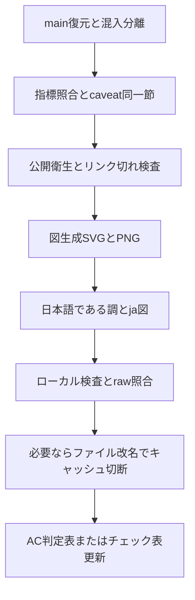

# 公開リポジトリ整備プレイブック

本稿は、公開リポジトリを証拠に基づくポートフォリオ品質へ揃えるための手順である。正本の適用例は本リポジトリ（`rsna-ich-reproducible-pipeline`）である。他リポジトリへ適用するときは、[PUBLIC_REPO_POLISH_CHECKLIST.md](PUBLIC_REPO_POLISH_CHECKLIST.md) を複製し、当該リポジトリの `docs/audit/` に記録する。

関連する合格判定の詳細は [acceptance_2026-11.md](acceptance_2026-11.md) を参照する。

## 0. 前提

- 通常環境の実データ・患者画像・秘密情報を外部へ送らない。
- 作業は隔離した worktree / クローンで行う。`main` への force push や reset は行わない。
- 表示確認は「ローカル生成物」「`raw.githubusercontent.com/<owner>/<repo>/<commit>/...`」「ブラウザの README」を取り違えない。



## 1. 証拠と主張

目的: README 等に載せる数値・主張が、追跡可能な一次成果から再計算できること。

- 数値の出典を要約 JSON 等の一次成果に固定する。
- 見出し数値と制約（例: 1 epoch、共通初期重み、同一検証データ、医療機器ではない、出典パス）を**同一の節**に置く。
- 可能なら CI で再計算照合する（本リポジトリ: `scripts/check_metric_claims.py`）。
- 指標 JSON が無いリポジトリは、本層を「該当なし」と記録し、定性主張の出典だけを明示する。

## 2. 公開衛生

目的: 公開物に機微情報や壊れた導線を含めないこと。

- 絶対パス、鍵らしき文字列、患者識別タグ、巨大な実行成果物を検査する。
- Markdown / HTML の相対リンク切れを検査する（追跡済みファイル集合に対して）。
- `.gitignore` の必須除外（データ・重み・実行結果）と、公開すべきソースの誤除外を検査する。
- 本リポジトリ: `scripts/check_public_hygiene.py`。

## 3. 図

目的: GitHub README で破綻せず、日英とも同じ構造の図を見せること。

- 生成スクリプトを1本に集約する（本リポジトリ: `docs/assets/generate_figures.py`）。
- 表示用は PNG。埋め込みは HTML ``（固定幅 SVG の横溢れを避ける）。
- 日本語文書は `*_ja.png` を参照する。英語は無印または `_en` を固定する。
- Mermaid に依存しない（日本語や GitHub 描画の失敗を避ける）。流れ図は静的 SVG/PNG とする。
- 短い接続線に SVG `marker-end` だけを頼らない。`line` + `polygon` で矢印を描く。
- 日本語の枠内切れを防ぐ。幅見積もりと折り返し、または 2×2 など広い配置にする。
- フォント指定は SVG 属性を壊さない引用符にする（二重引用の入れ子禁止）。

### 3.1 表示が古いときの切り分け

1. ローカル PNG の内容と寸法を確認する。
2. `raw.githubusercontent.com/<owner>/<repo>/<commit>/<path>` の SHA-256 とローカルを照合する。
3. 一致しているのに README が古い場合は、ブラウザキャッシュまたは GitHub camo キャッシュを疑う。
4. 必要ならアセットを改名し、Markdown の `src` を更新してキャッシュを切断する（本リポジトリ例: `eval_protocol*` → `eval_constraints*`）。

## 4. 日本語

目的: 学術・査読向けの文語で、口語の時間売り込みを含めないこと。

- 本文・箇条書きはである調に統一する。
- `.textlintrc.json` で `preset-ja-technical-writing` を用い、`preferInBody` / `preferInList` を「である」とする。
- 「概観（約30秒）」など時間を売る見出しを使わない。
- 用語は用語集（本リポジトリ: `docs/glossary_ja.md`）に合わせる。
- caveat「医療機器ではありません」は文言を勝手に崩さない。

## 5. 完了定義

ローカル:

- 該当する検査（claims / hygiene / textlint / 図再生成）に合格する。
- 日本語 README が `*_ja.png` を参照している。

遠隔:

- push 後、`raw.githubusercontent.com/.../<commit>/...` のハッシュがローカルと一致する。
- README をハードリロードし、改名後パスまたは最新コミットの図が表示される。

記録:

- 当該リポジトリの公開整備チェック表（`docs/audit/polish-*.md`）を更新する。
- 本リポジトリの手順を変えた場合は、下記「本リポジトリでの適用例」を更新する。

## 6. 本リポジトリでの適用例

本リポジトリでは、上記手順に沿って次を実施した。

- 指標主張の照合（`scripts/check_metric_claims.py`）と公開衛生検査（`scripts/check_public_hygiene.py`）
- 図の一括生成と GitHub 向け PNG 埋め込み（`width="100%"`）、日本語図 `*_ja.png`
- 日本語入口のである調統一と必須 caveat の併記
- 表示キャッシュ問題への対応として、制約図アセットの改名（`eval_protocol*` → `eval_constraints*`）

代表コミット（2026-11-11 前後）: `3b9a82a` / `03e6a08`（応答的 PNG）、`a675123`（日本語と `*_ja` 図）、`ee30ddb` / `992c83c` / `a8d5e31`（静的図とレイアウト）、`1b54171`（キャッシュ切断のための改名）。合格判定の詳細は [acceptance_2026-11.md](acceptance_2026-11.md) を参照する。

検査コマンド（リポジトリルート）:

```bash
python3 docs/assets/generate_figures.py
python3 scripts/check_metric_claims.py
python3 scripts/check_public_hygiene.py
npx --yes -p textlint -p textlint-rule-preset-ja-technical-writing \
  textlint --config .textlintrc.json README_ja.md docs/*_ja.md docs/releases/*_ja.md
```

主要パス:

- 図生成: `docs/assets/generate_figures.py`
- 指標照合: `scripts/check_metric_claims.py`
- 衛生: `scripts/check_public_hygiene.py`
- 日本語入口: `README_ja.md`
- 図索引: `docs/visual_index_ja.md`
- AC 判定: `docs/audit/acceptance_2026-11.md`

## 7. 本手順を適用した関連公開リポジトリ

同系統の公開パイプラインおよびプロフィールでも、本手順に沿った整備を行っている。詳細な判定記録は各リポジトリ側の文書を参照する。

- [isles2022-3d-reproducible-pipeline](https://github.com/yskfuji/isles2022-3d-reproducible-pipeline)
- [isles2022-2p5d-reproducible-pipeline](https://github.com/yskfuji/isles2022-2p5d-reproducible-pipeline)
- [isles2022-2d3d-blend-reproducible-pipeline](https://github.com/yskfuji/isles2022-2d3d-blend-reproducible-pipeline)
- [yskfuji（GitHub プロフィール）](https://github.com/yskfuji/yskfuji)
