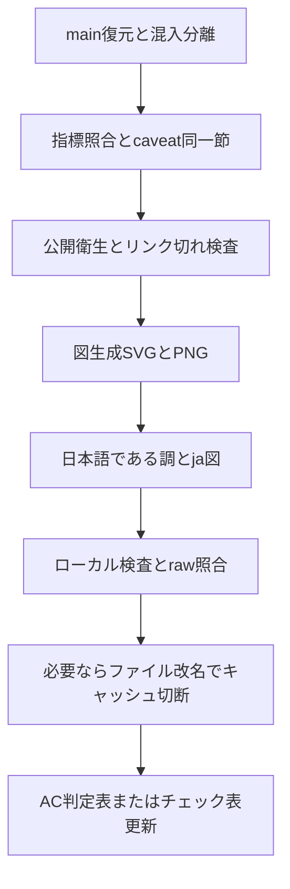

# 公開リポジトリ整備プレイブック

本稿は、yskfuji 配下の公開リポジトリを、証拠に基づくポートフォリオ品質へ揃えるための手順である。正本適用例は本リポジトリ（`rsna-ich-reproducible-pipeline`）である。横展開時は [PUBLIC_REPO_POLISH_CHECKLIST.md](PUBLIC_REPO_POLISH_CHECKLIST.md) をリポジトリごとに複製して記入する。

関連する合格判定の詳細は [acceptance_2026-11.md](acceptance_2026-11.md) を参照する。

## 0. 前提

- 通常環境の実データ・患者画像・秘密情報を外部へ送らない。
- 作業は隔離した worktree / クローンで行う。`main` への force push や reset は行わない。
- 表示確認は「ローカル生成物」「`raw.githubusercontent.com/<owner>/<repo>/<commit>/...`」「ブラウザの README」を取り違えない。



## 1. 証拠と主張

目的: README 等に載せる数値・主張が、追跡可能な一次成果から再計算できること。

- 数値の出典を要約 JSON 等の一次成果に固定する。
- 見出し数値と制約（例: 1 epoch、共通初期重み、同一検証データ、医療機器ではない、出典パス）を**同一の節**に置く。
- 可能なら CI で再計算照合する（本リポジトリ: `scripts/check_metric_claims.py`）。
- 指標 JSON が無いリポジトリは、本層を「該当なし」と記録し、定性主張の出典だけを明示する。

## 2. 公開衛生

目的: 公開物に機微情報や壊れた導線を含めないこと。

- 絶対パス、鍵らしき文字列、患者識別タグ、巨大な実行成果物を検査する。
- Markdown / HTML の相対リンク切れを検査する（追跡済みファイル集合に対して）。
- `.gitignore` の必須除外（データ・重み・実行結果）と、公開すべきソースの誤除外を検査する。
- 本リポジトリ: `scripts/check_public_hygiene.py`。

## 3. 図

目的: GitHub README で破綻せず、日英とも同じ構造の図を見せること。

- 生成スクリプトを1本に集約する（本リポジトリ: `docs/assets/generate_figures.py`）。
- 表示用は PNG。埋め込みは HTML ``（固定幅 SVG の横溢れを避ける）。
- 日本語文書は `*_ja.png` を参照する。英語は無印または `_en` を固定する。
- Mermaid に依存しない（日本語や GitHub 描画の失敗を避ける）。流れ図は静的 SVG/PNG とする。
- 短い接続線に SVG `marker-end` だけを頼らない。`line` + `polygon` で矢印を描く。
- 日本語の枠内切れを防ぐ。幅見積もりと折り返し、または 2×2 など広い配置にする。
- フォント指定は SVG 属性を壊さない引用符にする（二重引用の入れ子禁止）。

### 3.1 表示が古いときの切り分け

1. ローカル PNG の内容と寸法を確認する。
2. `raw.githubusercontent.com/<owner>/<repo>/<commit>/<path>` の SHA-256 とローカルを照合する。
3. 一致しているのに README が古い場合は、ブラウザキャッシュまたは GitHub camo キャッシュを疑う。
4. 必要ならアセットを改名し、Markdown の `src` を更新してキャッシュを切断する（本リポジトリ例: `eval_protocol*` → `eval_constraints*`）。

## 4. 日本語

目的: 学術・査読向けの文語で、口語の時間売り込みを含めないこと。

- 本文・箇条書きはである調に統一する。
- `.textlintrc.json` で `preset-ja-technical-writing` を用い、`preferInBody` / `preferInList` を「である」とする。
- 「概観（約30秒）」など時間を売る見出しを使わない。
- 用語は用語集（本リポジトリ: `docs/glossary_ja.md`）に合わせる。
- caveat「医療機器ではありません」は文言を勝手に崩さない。

## 5. 完了定義

ローカル:

- 該当する検査（claims / hygiene / textlint / 図再生成）に合格する。
- 日本語 README が `*_ja.png` を参照している。

遠隔:

- push 後、`raw.githubusercontent.com/.../<commit>/...` のハッシュがローカルと一致する。
- README をハードリロードし、改名後パスまたは最新コミットの図が表示される。

記録:

- 本プレイブックの「適用ログ」へ、リポジトリ名・日付・コミット・判定を追記する。
- リポジトリ固有の行はチェック表ファイルに残す。

## 6. 適用ログ

### 6.1 rsna-ich-reproducible-pipeline（正本）

| 日付 | コミット | 内容 |
|---|---|---|
| 2026-11-11 | `1b54171` | 制約図を `eval_constraints*` へ改名しキャッシュ切断 |
| 2026-11-11 | `a8d5e31` | 文言切れ防止・2×2制約図・縦TD中心揃え |
| 2026-11-11 | `992c83c` | アーキテクチャを縦一列 TD に再描画 |
| 2026-11-11 | `ee30ddb` | 接続線修正、Mermaid TD を静的 `smoke_flow` に置換 |
| 2026-11-11 | `a675123` | 日本語をである調へ統一し `*_ja.png` 参照 |
| 2026-11-11 | `3b9a82a` / `03e6a08` | 応答的 PNG 埋め込み |

検査コマンド（リポジトリルート）:

```bash
python3 docs/assets/generate_figures.py
python3 scripts/check_metric_claims.py
python3 scripts/check_public_hygiene.py
npx --yes -p textlint -p textlint-rule-preset-ja-technical-writing \
  textlint --config .textlintrc.json README_ja.md docs/*_ja.md docs/releases/*_ja.md
```

主要パス:

- 図生成: `docs/assets/generate_figures.py`
- 指標照合: `scripts/check_metric_claims.py`
- 衛生: `scripts/check_public_hygiene.py`
- 日本語入口: `README_ja.md`
- 図索引: `docs/visual_index_ja.md`
- AC 判定: `docs/audit/acceptance_2026-11.md`

### 6.2 横展開（記入欄）

| リポジトリ | 日付 | 先端コミット | 判定要約 | チェック表 |
|---|---|---|---|---|
| isles2022-3d-reproducible-pipeline | 2026-11-11 | `7d4d528` | PNG/`*_ja`・である調・caveat・raw一致 | 各 repo: `docs/audit/polish-isles2022-3d.md` |
| isles2022-2p5d-reproducible-pipeline | 2026-11-11 | `97d1b0b` | 同上（main に統合、コンフリクト解消含む） | `docs/audit/polish-isles2022-2p5d.md` |
| isles2022-2d3d-blend-reproducible-pipeline | 2026-11-11 | `7c46ac6` | 空 assets を埋め、JA/PNG/caveat・raw一致 | `docs/audit/polish-isles2022-2d3d-blend.md` |
| yskfuji（profile） | 2026-11-11 | （profile push 後） | blend 追加・医療機器ではない旨・である調維持 | プロフィールは README のみ |

## 7. 第1波の範囲

対象:

- `isles2022-3d-reproducible-pipeline`
- `isles2022-2p5d-reproducible-pipeline`
- `isles2022-2d3d-blend-reproducible-pipeline`
- `yskfuji`（プロフィール）

当面除外: private、および製品・別系統（PharmShiftMaker、FamilyHub、ATAS、OCR eval 等）。
