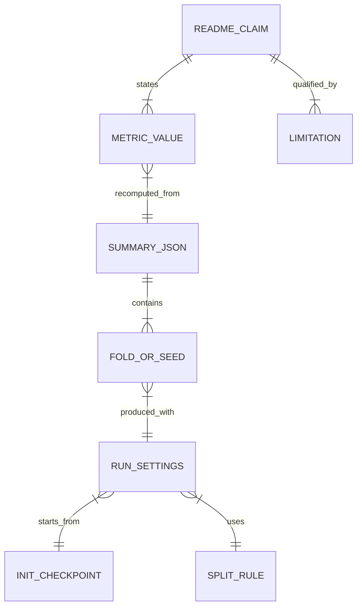

# Evaluation notes: what the headline numbers mean

**Language:** English | [Japanese](evaluation_notes_ja.md)

This page explains what the headline metrics in the READMEs measure, what they do not measure, and where each number comes from. Every value below is recomputed in CI from [`core/pipeline/reports/rsna_cv_summary.json`](../core/pipeline/reports/rsna_cv_summary.json) by [`scripts/check_metric_claims.py`](../scripts/check_metric_claims.py).

## 1. Headline numbers

Values are mean ± sample standard deviation (ddof=1).

| Metric | Value | n | Protocol |
|---|---:|---:|---|
| Weighted multi-label logloss ↓ | 0.05346 ± 0.00624 | 5 folds | Study-level GroupKFold(5), 6,852 images, 1 epoch fine-tuning per fold |
| Mean AUC over 6 labels ↑ | 0.98815 ± 0.00311 | 5 folds | same as above |
| Error-detection AUROC (`any`) ↑ | 0.9424 ± 0.0200 | 10 seeds | Study-level holdout (about 5%, 334–354 images per seed), de-duplicated, dropout retraining, 30 MC Dropout samples |
| ECE (`any`) ↓ | 0.0231 ± 0.0034 | 10 seeds | same as above, 15 equal-width bins, after temperature scaling |
| Brier score (`any`) ↓ | 0.0209 ± 0.0057 | 10 seeds | same as above |
| AURC (risk = weighted logloss) ↓ | 0.00837 ± 0.00225 | 10 seeds | same as above |
| Accuracy gain at coverage 0.8 (`any`) | +2.53 ± 0.94 pp | 10 seeds | same as above |

## 2. Limitations (read before citing the numbers)

1. **Short training budget.** Each fold or seed fine-tunes for 1 epoch on an 8,000-image subsample. The numbers show how stable fine-tuning is; they are not a full training run.
2. **Initial checkpoint overlap.** All runs start from the same initial checkpoint (`rsna_convnext25d_final2_full_mps_nosamp_nopw_20260202_222608/best.pt`). It was trained for 6 epochs on 632,808 slices, holding out only 2% of studies (`val_frac=0.02`). The 8,000-image subsample comes from the same `stage_2_train` pool. We therefore expect about 98% of each validation fold to have been training data for the initial checkpoint. This is an expected value; the exact overlap has not been measured. The numbers must not be read as performance on unseen studies.
3. **Calibration fitted on the evaluation set.** The temperature is fitted on the same holdout used for ECE, Brier and AURC (fit set = evaluation set), so these values are optimistic.
4. **Study-level, not patient-level, splits.** The split groups by `StudyInstanceUID`. A patient with several studies can appear on both sides of a split. Patient-level grouping is not implemented.
5. **Fold-to-fold spread understates uncertainty.** Fold results share training data and are correlated, so the standard deviation across folds is not an unbiased estimate of the variance of the CV estimate (Bengio and Grandvalet, 2004).
6. **Small uncertainty holdouts.** Each seed evaluates 334–354 images from 293–297 studies; 15–16% of those studies contain hemorrhage.
7. **Post-processing.** All CV scores apply `enforce_any_max=True`, which sets p(`any`) to at least the largest subtype probability before scoring.
8. **Not a medical device.** This repository is a research and portfolio implementation. It has not been validated for clinical use and must not be used for diagnosis.

## 3. Metric definitions

| Metric | Definition in this repository | Source in code | Reference |
|---|---|---|---|
| Weighted multi-label logloss | Binary cross-entropy per label, weighted `any` = 2 and each of the 5 subtypes = 1, normalised by 7 | `RSNA_LOGLOSS_CLASS_WEIGHTS` in `src/training/train_rsna_cnn2d_classifier.py` | Kaggle states only that `any` is weighted more heavily than the subtypes. The weight 2 is the value widely used by participants, not an official figure. |
| Labels | `epidural`, `intraparenchymal`, `intraventricular`, `subarachnoid`, `subdural`, plus `any` (any hemorrhage present) | `RSNA_CLASSES` in `src/datasets/rsna_ich_dataset.py` | Flanders et al., 2020 |
| Error-detection AUROC | AUROC for separating wrong from correct `any` predictions (threshold 0.5) by the MC Dropout standard deviation of p(`any`) | `tools/eval_rsna_uncertainty.py` | Gal and Ghahramani, 2016 |
| ECE | Expected calibration error for `any` over 15 equal-width bins | `_ece_binary` in `tools/eval_rsna_uncertainty.py` | Naeini et al., 2015; Guo et al., 2017 |
| Temperature scaling | One temperature shared by all 6 labels, fitted by LBFGS to minimise the weighted BCE and clamped to [0.5, 10] | `_fit_temperature` in `tools/eval_rsna_uncertainty.py` | Guo et al., 2017 |
| AURC | Mean selective risk over all n coverages, ordered from most to least confident. The original definition allows any loss and its experiments use the 0/1 error; here the risk is the weighted logloss | `_aurc` in `tools/eval_rsna_uncertainty.py` | Geifman et al., 2019 |

## 4. Evidence chain

- `README_CLAIM` → `METRIC_VALUE`: checked in CI by `scripts/check_metric_claims.py`.
- `SUMMARY_JSON` → `FOLD_OR_SEED`: exported from the private run directories by `core/pipeline/tools/export_metric_summary.py`. Image IDs and file paths are not exported.
- `RUN_SETTINGS` → `INIT_CHECKPOINT`: recorded under `settings.init_from` and `init_checkpoint` in the JSON.

## 5. References

- Flanders AE, et al. Construction of a Machine Learning Dataset through Collaboration: The RSNA 2019 Brain CT Hemorrhage Challenge. *Radiology: Artificial Intelligence*. 2020;2(3):e190211. <https://doi.org/10.1148/ryai.2020190211>
- Kaggle. RSNA Intracranial Hemorrhage Detection (2019), Evaluation. <https://www.kaggle.com/competitions/rsna-intracranial-hemorrhage-detection/overview/evaluation>
- Naeini MP, Cooper GF, Hauskrecht M. Obtaining Well Calibrated Probabilities Using Bayesian Binning. *AAAI*. 2015.
- Guo C, Pleiss G, Sun Y, Weinberger KQ. On Calibration of Modern Neural Networks. *ICML*. 2017.
- Gal Y, Ghahramani Z. Dropout as a Bayesian Approximation: Representing Model Uncertainty in Deep Learning. *ICML*. 2016.
- Geifman Y, Uziel G, El-Yaniv R. Bias-Reduced Uncertainty Estimation for Deep Neural Classifiers. *ICLR*. 2019. <https://arxiv.org/abs/1805.08206>
- Bengio Y, Grandvalet Y. No Unbiased Estimator of the Variance of K-Fold Cross-Validation. *JMLR*. 2004;5:1089–1105. <https://www.jmlr.org/papers/v5/grandvalet04a.html>
