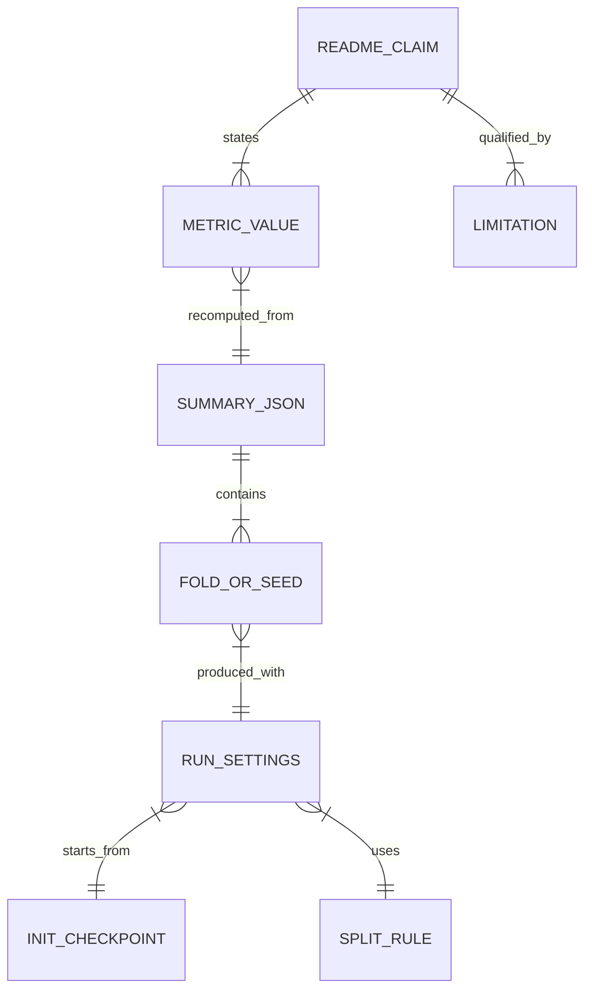

# 評価ノート：代表指標が示すもの

**言語:** [英語版](evaluation_notes.md) | 日本語

このページでは、READMEに載せている代表指標について、測った内容と測っていない内容、および値の出典を説明します。以下の数値の出典は [`core/pipeline/reports/rsna_cv_summary.json`](../core/pipeline/reports/rsna_cv_summary.json) です。CIでは [`scripts/check_metric_claims.py`](../scripts/check_metric_claims.py) がこのJSONから数値を計算し直し、文書の記載と照合します。

## 1. 代表指標

表記は「平均 ± 標本標準偏差（ddof=1）」です。

| 指標 | 値 | n | 評価条件 |
|---|---:|---:|---|
| 加重マルチラベル対数損失（低いほど良い） | 0.05346 ± 0.00624 | 5 fold | 検査単位のGroupKFold(5)、6,852画像、各foldで1エポックの追加学習 |
| 6ラベルの平均AUC（高いほど良い） | 0.98815 ± 0.00311 | 5 fold | 同上 |
| 誤り検出AUROC（`any`、高いほど良い） | 0.9424 ± 0.0200 | 10シード | 検査単位のホールドアウト（約5%、各シード334〜354画像）、重複除去あり、Dropout付きで再学習、MC Dropoutの標本数30 |
| ECE（`any`、低いほど良い） | 0.0231 ± 0.0034 | 10シード | 同上。等幅15区間、温度スケーリング後 |
| Brierスコア（`any`、低いほど良い） | 0.0209 ± 0.0057 | 10シード | 同上 |
| AURC（リスクは加重対数損失、低いほど良い） | 0.00837 ± 0.00225 | 10シード | 同上 |
| 被覆率0.8での正解率の改善幅（`any`） | +2.53 ± 0.94 pp | 10シード | 同上 |

## 2. 制約（数値を引用する前に必ず確認してください）

1. **学習量が少ない**：各foldと各シードは、8,000画像の抽出データで1エポックだけ追加学習しています。数値が示すのは追加学習の安定性であり、本格的な学習の成績ではありません。
2. **初期重みが検証データを学習済みの可能性が高い**：すべての実行は、同じ初期重みから始めています。そのファイルは `rsna_convnext25d_final2_full_mps_nosamp_nopw_20260202_222608/best.pt` です。この初期重みは632,808スライスで6エポック学習したもので、検証用に残したのは全検査の2%（`val_frac=0.02`）だけです。8,000画像の抽出データも同じ `stage_2_train` から取っています。そのため、各foldの検証画像のおよそ98%は、初期重みの学習に使われていたと推定されます。これは期待値による推定で、実際の重なりはまだ測っていません。したがって、これらの数値を未知の検査に対する性能として読まないでください。
3. **校正と評価に同じ検証データを使っている**：温度パラメータは、ECE、Brierスコア、AURCの評価に使うホールドアウトと同じデータで推定しています。そのため、これらの値は楽観的に出ます。
4. **分割は検査単位で、患者単位ではない**：分割は `StudyInstanceUID` でまとめています。複数の検査を受けた患者は、学習側と検証側の両方に入る可能性があります。患者単位の分割はまだ実装していません。
5. **fold間のばらつきは不確かさを過小に見せる**：fold同士は学習データを共有しているため、結果に相関があります。そのため、fold間の標準偏差は交差検証の推定値の分散を偏りなく表しません（Bengio and Grandvalet, 2004）。
6. **不確実性評価の検証データが小さい**：各シードで評価したのは293〜297検査の334〜354画像です。そのうち出血を含む検査は15〜16%です。
7. **後処理**：交差検証のスコアはすべて `enforce_any_max=True` を適用した後の値です。この後処理では、p(`any`) を各サブタイプの確率の最大値以上に引き上げてから採点します。
8. **医療機器ではありません**：このリポジトリは研究とポートフォリオのための実装です。臨床での妥当性は検証しておらず、診断には使えません。

## 3. 指標の定義

| 指標 | このリポジトリでの定義 | 実装箇所 | 出典 |
|---|---|---|---|
| 加重マルチラベル対数損失 | ラベルごとの二値交差エントロピーを、`any` は2、5つのサブタイプは各1で重み付けし、7で割った値 | `src/training/train_rsna_cnn2d_classifier.py` の `RSNA_LOGLOSS_CLASS_WEIGHTS` | Kaggleの公式説明は「`any` をサブタイプより重く扱う」とだけ述べています。重み2は参加者の間で広く使われている値で、公式の値ではありません。 |
| ラベル | `epidural`（硬膜外）、`intraparenchymal`（脳実質内）、`intraventricular`（脳室内）、`subarachnoid`（くも膜下）、`subdural`（硬膜下）と、いずれかの出血があることを示す `any` | `src/datasets/rsna_ich_dataset.py` の `RSNA_CLASSES` | Flanders et al., 2020 |
| 誤り検出AUROC | 閾値0.5で判定した `any` の予測の正誤を、p(`any`) のMC Dropout標準偏差でどれだけ見分けられるかを表すAUROC | `tools/eval_rsna_uncertainty.py` | Gal and Ghahramani, 2016 |
| ECE | `any` の期待校正誤差。確率を等幅15区間に分けて計算 | `tools/eval_rsna_uncertainty.py` の `_ece_binary` | Naeini et al., 2015; Guo et al., 2017 |
| 温度スケーリング | 6ラベル共通の温度1つを、加重BCEが最小になるようにLBFGSで推定（範囲は0.5〜10） | `tools/eval_rsna_uncertainty.py` の `_fit_temperature` | Guo et al., 2017 |
| AURC | 確信度の高い順に並べたときの、全被覆率にわたるリスクの平均。原論文はリスクに0/1誤りを使いますが、このリポジトリでは加重対数損失を使います | `tools/eval_rsna_uncertainty.py` の `_aurc` | Geifman et al., 2019 |

## 4. 根拠のつながり

- READMEの記載と指標値の一致は、CIで `scripts/check_metric_claims.py` が検査します。
- 出典JSONのfold別・シード別の値は、`core/pipeline/tools/export_metric_summary.py` が非公開の実行結果から書き出したものです。画像IDとファイルパスは書き出していません。
- 初期重みの情報は、JSONの `settings.init_from` と `init_checkpoint` に記録しています。

## 5. 参考文献

- Flanders AE, et al. Construction of a Machine Learning Dataset through Collaboration: The RSNA 2019 Brain CT Hemorrhage Challenge. *Radiology: Artificial Intelligence*. 2020;2(3):e190211. <https://doi.org/10.1148/ryai.2020190211>
- Kaggle. RSNA Intracranial Hemorrhage Detection (2019), Evaluation. <https://www.kaggle.com/competitions/rsna-intracranial-hemorrhage-detection/overview/evaluation>
- Naeini MP, Cooper GF, Hauskrecht M. Obtaining Well Calibrated Probabilities Using Bayesian Binning. *AAAI*. 2015.
- Guo C, Pleiss G, Sun Y, Weinberger KQ. On Calibration of Modern Neural Networks. *ICML*. 2017.
- Gal Y, Ghahramani Z. Dropout as a Bayesian Approximation: Representing Model Uncertainty in Deep Learning. *ICML*. 2016.
- Geifman Y, Uziel G, El-Yaniv R. Bias-Reduced Uncertainty Estimation for Deep Neural Classifiers. *ICLR*. 2019. <https://arxiv.org/abs/1805.08206>
- Bengio Y, Grandvalet Y. No Unbiased Estimator of the Variance of K-Fold Cross-Validation. *JMLR*. 2004;5:1089–1105. <https://www.jmlr.org/papers/v5/grandvalet04a.html>
