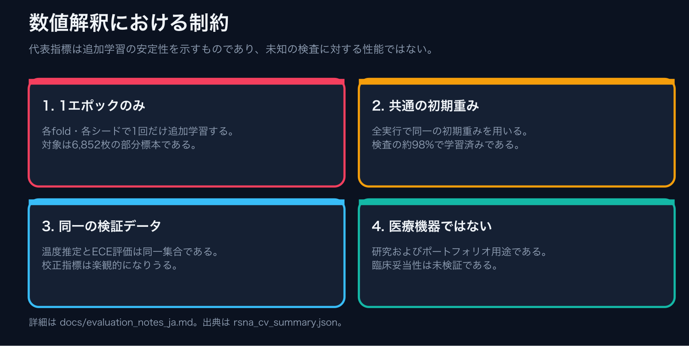
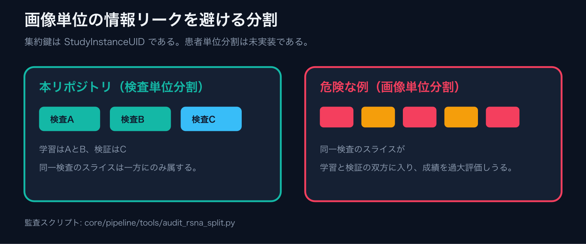
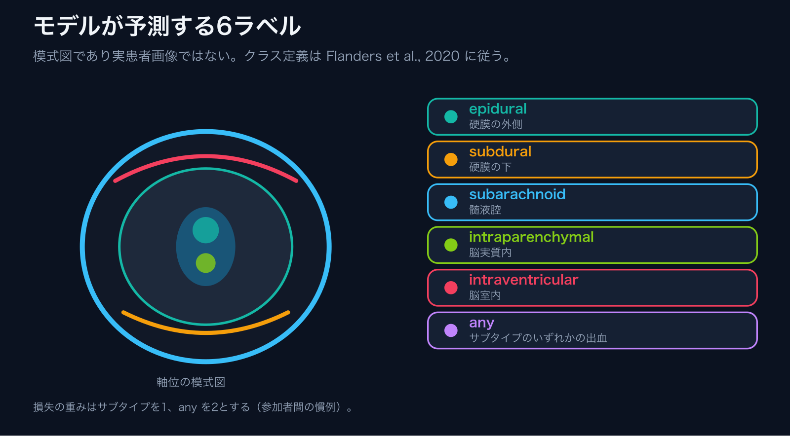
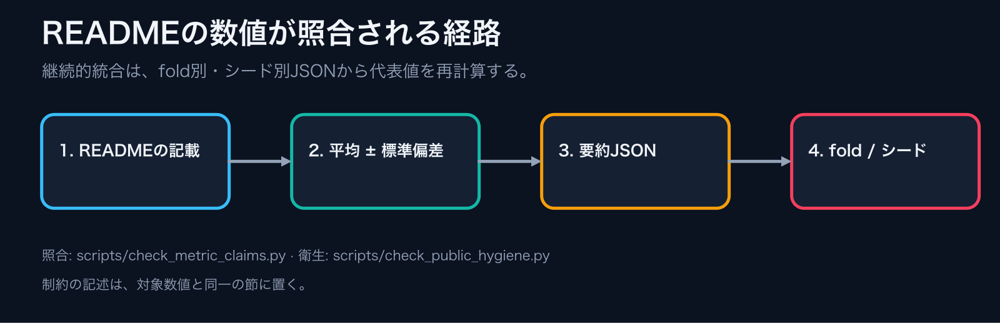
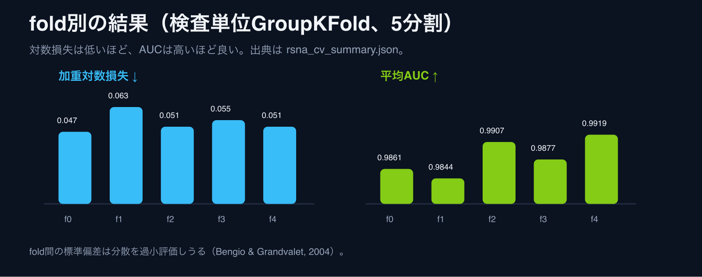
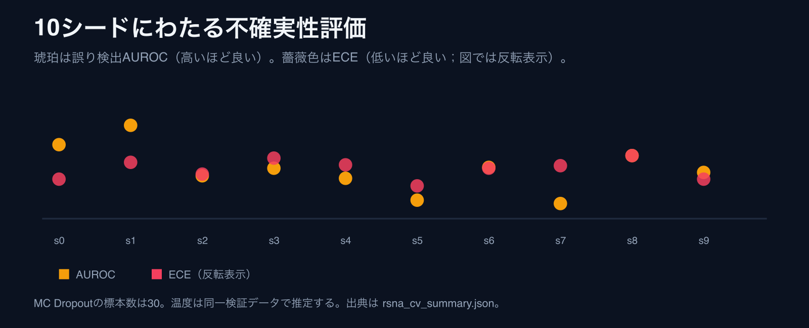
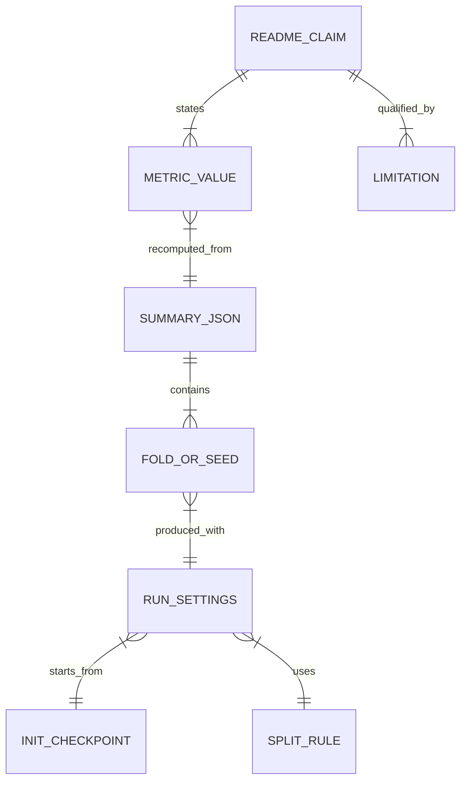

# 評価ノート：代表指標の解釈

**言語:** [英語版](evaluation_notes.md) | 日本語。

本稿は、READMEに掲載する代表指標について、測定した内容、測定していない内容、および値の出典を整理する。以下の数値の出典は [`core/pipeline/reports/rsna_cv_summary.json`](../core/pipeline/reports/rsna_cv_summary.json) である。継続的統合（CI）では [`scripts/check_metric_claims.py`](../scripts/check_metric_claims.py) が同JSONから数値を再計算し、文書記載と照合する。

## 0. 図による整理

<p align="center"></p>

*要点は次の四点である。追加学習は1エポックに限る。初期重みは共通である。校正と評価は同じ検証データを用いる。医療機器ではない。*

<p align="center"></p>

<p align="center"></p>

*図は模式図である。実患者の画像ではない。*

<p align="center"></p>

<p align="center"></p>

<p align="center"></p>

## 1. 代表指標

表記は「平均 ± 標本標準偏差（ddof=1）」とする。

| 指標 | 値 | n | 評価条件 |
|---|---:|---:|---|
| 加重マルチラベル対数損失（低いほど良い） | 0.05346 ± 0.00624 | 5 fold | 検査単位のGroupKFold(5)、6,852画像、各foldで1エポックの追加学習 |
| 6ラベルの平均AUC（高いほど良い） | 0.98815 ± 0.00311 | 5 fold | 同上 |
| 誤り検出AUROC（`any`、高いほど良い） | 0.9424 ± 0.0200 | 10シード | 検査単位のホールドアウト（約5%、各シード334〜354画像）、重複除去あり、Dropout付きで再学習、MC Dropoutの標本数30 |
| ECE（`any`、低いほど良い） | 0.0231 ± 0.0034 | 10シード | 同上。等幅15区間、温度スケーリング後 |
| Brierスコア（`any`、低いほど良い） | 0.0209 ± 0.0057 | 10シード | 同上 |
| AURC（リスクは加重対数損失、低いほど良い） | 0.00837 ± 0.00225 | 10シード | 同上 |
| 被覆率0.8での正解率の改善幅（`any`） | +2.53 ± 0.94 pp | 10シード | 同上 |

## 2. 制約（数値を引用する前に確認すること）

1. **学習量が限られている**：各foldと各シードは、`limit_images=8000` で抽出したデータ（交差検証では、前処理済みデータにない画像を除いた6,852枚）で1エポックだけ追加学習している。数値が示すのは追加学習の安定性であり、本格的な学習成績ではない。
2. **初期重みが検証データを学習済みである可能性が高い**：すべての実行は、同じ初期重みから開始する。当該ファイルは `rsna_convnext25d_final2_full_mps_nosamp_nopw_20260202_222608/best.pt` である。この初期重みは、前処理済みの645,793スライスのうち632,808スライスで6エポック学習したものである。検証用に残したのは全検査の2%（`val_frac=0.02`）にすぎない。交差検証および不確実性評価の抽出データも、同じ前処理済みデータに由来する。よって各foldの検証画像のおよそ98%は、初期重みの学習に用いられていたと推定される。これは期待値に基づく推定であり、実際の重なりは未測定である。したがってこれらの数値を、未知の検査に対する性能として解釈してはならない。
3. **校正と評価に同じ検証データを用いている**：温度パラメータは、ECE、Brierスコア、AURCの評価に用いるホールドアウトと同一のデータで推定している。このためこれらの値は楽観的に偏りうる。
4. **分割は検査単位であり、患者単位ではない**：分割は `StudyInstanceUID` で集約する。複数検査を有する患者は、学習側と検証側の双方に現れうる。患者単位の分割は未実装である。
5. **fold間のばらつきは不確かさを過小評価しうる**：fold同士は学習データを共有するため結果に相関がある。ゆえにfold間の標準偏差は、交差検証による推定値の分散を不偏に表さない（Bengio and Grandvalet, 2004）。
6. **不確実性評価の検証データは小さい**：各シードで評価したのは293〜297検査の334〜354画像である。うち出血を含む検査は15〜16%である。
7. **後処理**：交差検証のスコアはすべて `enforce_any_max=True` 適用後の値である。この後処理は、p(`any`) を各サブタイプ確率の最大値以上に引き上げてから採点する。
8. **医療機器ではありません**：本リポジトリは研究およびポートフォリオのための実装である。臨床妥当性は未検証であり、診断には用いてはならない。

## 3. 指標の定義

| 指標 | 本リポジトリにおける定義 | 実装箇所 | 出典 |
|---|---|---|---|
| 加重マルチラベル対数損失 | ラベルごとの二値交差エントロピーを、`any` は2、5つのサブタイプは各1で重み付けし、7で除した値 | `src/training/train_rsna_cnn2d_classifier.py` の `RSNA_LOGLOSS_CLASS_WEIGHTS` | Kaggleの公式説明は「`any` をサブタイプより重く扱う」と述べるにとどまる。重み2は参加者間で広く用いられる値であり、公式値ではない。 |
| ラベル | `epidural`（硬膜外）、`intraparenchymal`（脳実質内）、`intraventricular`（脳室内）、`subarachnoid`（くも膜下）、`subdural`（硬膜下）と、いずれかの出血の有無を示す `any` | `src/datasets/rsna_ich_dataset.py` の `RSNA_CLASSES` | Flanders et al., 2020 |
| 誤り検出AUROC | 閾値0.5で判定した `any` 予測の正誤を、p(`any`) のMC Dropout標準偏差で識別するAUROC | `tools/eval_rsna_uncertainty.py` | Gal and Ghahramani, 2016 |
| ECE | `any` の期待校正誤差。確率を等幅15区間に分割して算出する | `tools/eval_rsna_uncertainty.py` の `_ece_binary` | Naeini et al., 2015; Guo et al., 2017 |
| 温度スケーリング | 6ラベル共通の温度1つを、加重BCEが最小となるようLBFGSで推定する（範囲は0.5〜10） | `tools/eval_rsna_uncertainty.py` の `_fit_temperature` | Guo et al., 2017 |
| AURC | 確信度の高い順に並べたときの、n通りの被覆率にわたる選択的リスクの平均である。原論文の定義は任意の損失を認め、実験では0/1誤りを用いる。本リポジトリでは加重対数損失を用いる | `tools/eval_rsna_uncertainty.py` の `_aurc` | Geifman et al., 2019 |

## 4. 根拠のつながり



- READMEの記載と指標値の一致は、CIにおいて `scripts/check_metric_claims.py` が検査する。
- 出典JSONのfold別・シード別の値は、`core/pipeline/tools/export_metric_summary.py` が非公開の実行結果から書き出したものである。画像IDおよびファイルパスは書き出していない。
- 初期重みの情報は、JSONの `settings.init_from` および `init_checkpoint` に記録する。

## 5. 参考文献

次の文献を参照する。書誌情報は英語表記のまま示す。

```
Flanders AE, et al. The RSNA 2019 Brain CT Hemorrhage Challenge.
Radiology: Artificial Intelligence. 2020;2(3):e190211.
https://doi.org/10.1148/ryai.2020190211

Kaggle. RSNA Intracranial Hemorrhage Detection (2019), Evaluation.
https://www.kaggle.com/competitions/rsna-intracranial-hemorrhage-detection/overview/evaluation

Naeini MP, et al. Obtaining Well Calibrated Probabilities Using Bayesian Binning. AAAI. 2015.

Guo C, et al. On Calibration of Modern Neural Networks. ICML. 2017.

Gal Y, Ghahramani Z. Dropout as a Bayesian Approximation. ICML. 2016.

Geifman Y, et al. Bias-Reduced Uncertainty Estimation. ICLR. 2019.
https://arxiv.org/abs/1805.08206

Bengio Y, Grandvalet Y. No Unbiased Estimator of the Variance of K-Fold CV.
JMLR. 2004;5:1089–1105.
https://www.jmlr.org/papers/v5/grandvalet04a.html
```

