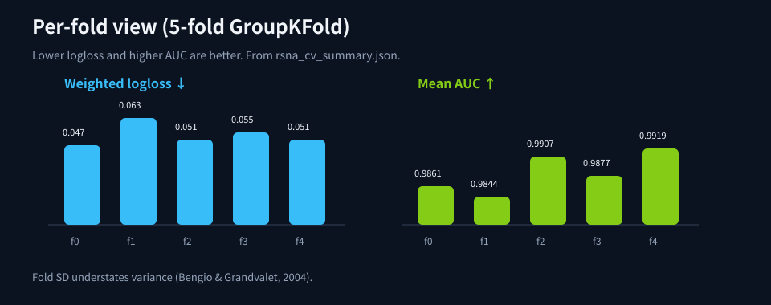
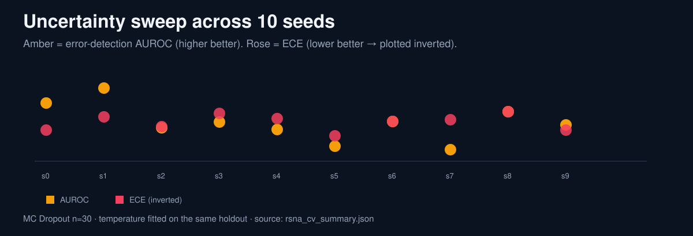
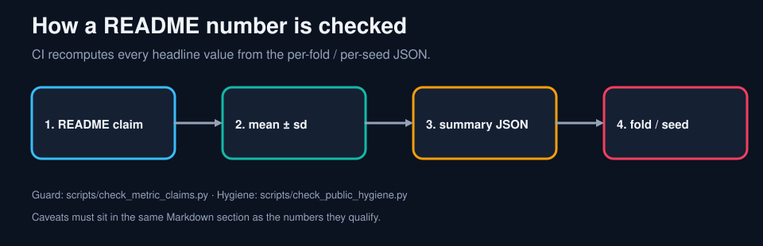
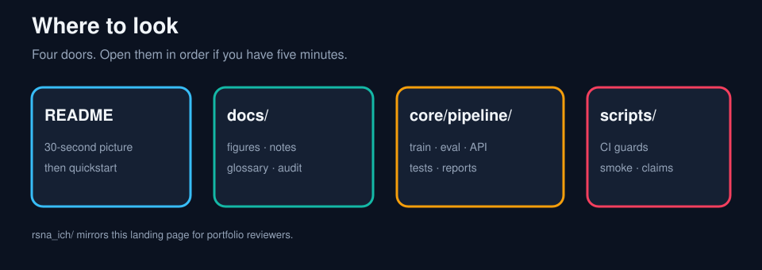

# Picture-only index

**Language:** English | [Japanese](visual_index_ja.md)

Almost no prose. Scroll the figures. For what the numbers mean, open [evaluation_notes.md](evaluation_notes.md).

## Pipeline


## Labels


## Split


## Metrics






## How to read the numbers




## Repository




## Regenerate

```bash
python docs/assets/generate_figures.py
```

Metric cards are filled from `core/pipeline/reports/rsna_cv_summary.json`. No patient pixels.
