# 図索引

**言語:** 日本語 | [英語版](visual_index.md)

本稿は文章を最小限にとどめ、図の閲覧順を示す。数値の解釈は [evaluation_notes_ja.md](evaluation_notes_ja.md)、用語は [glossary_ja.md](glossary_ja.md) を参照する。

## 処理構成

<p align="center">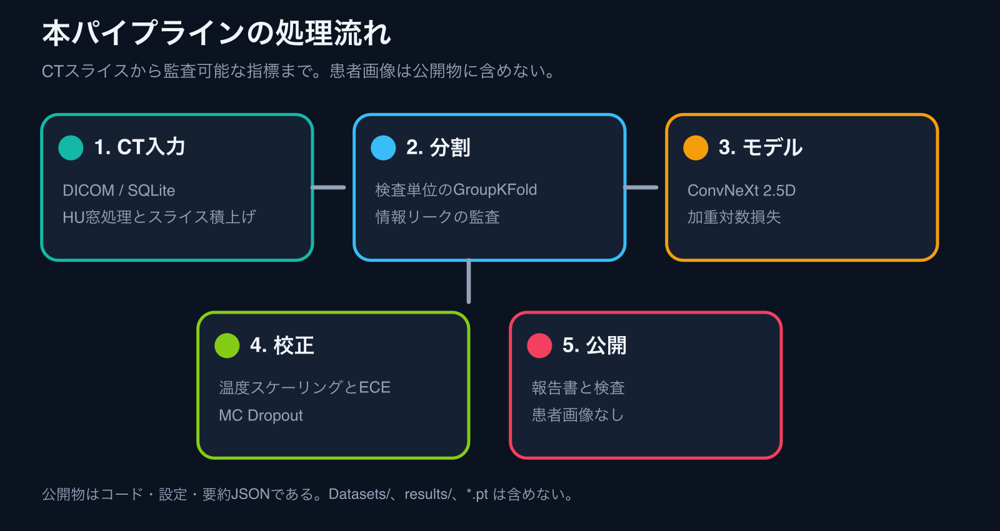</p>

## 動作確認の流れ

<p align="center">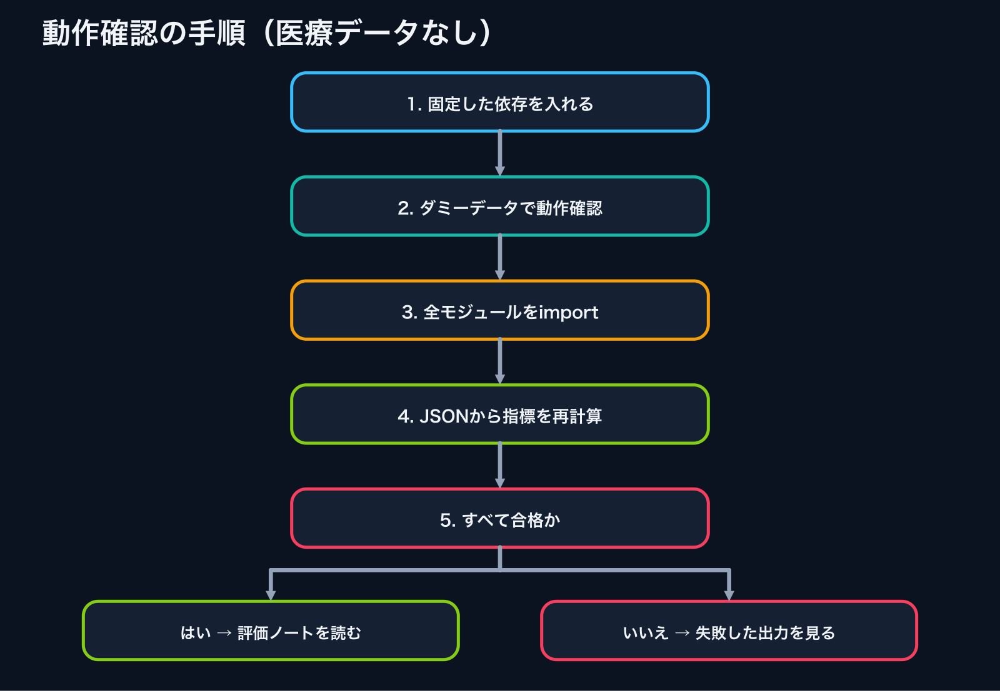</p>

## 予測ラベル

<p align="center">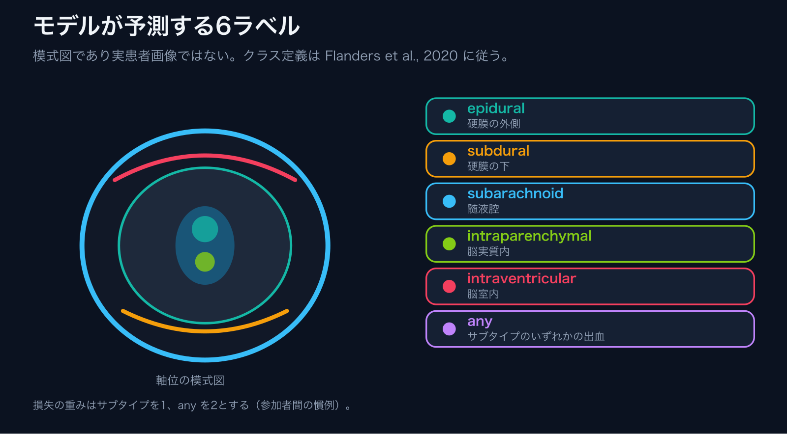</p>

## 分割

<p align="center">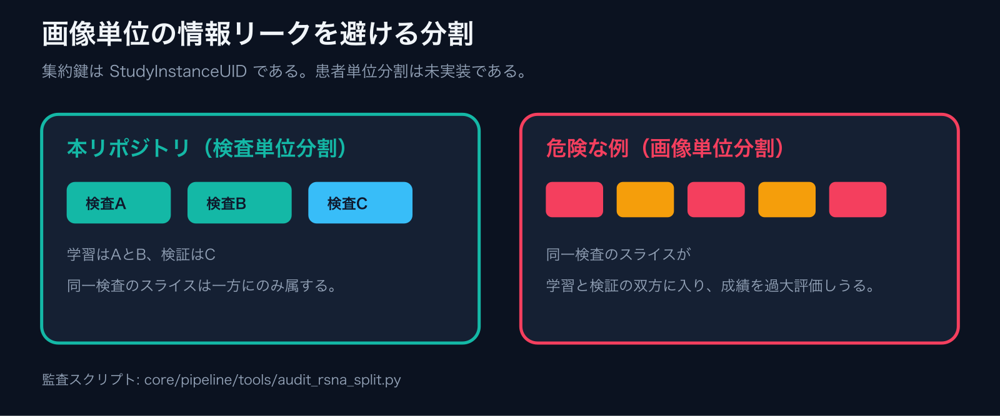</p>

## 指標

<p align="center">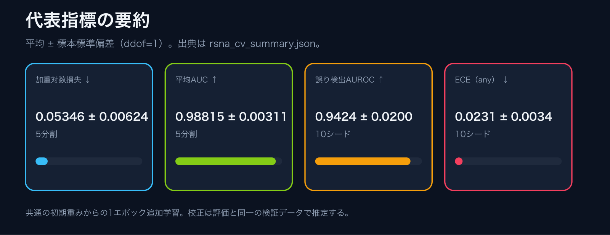</p>

<p align="center">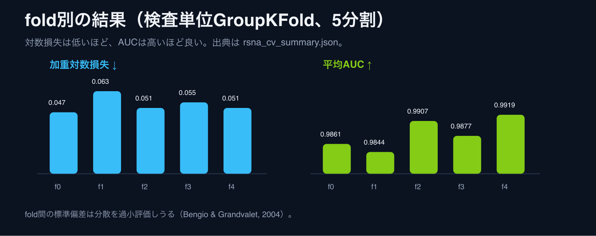</p>

<p align="center">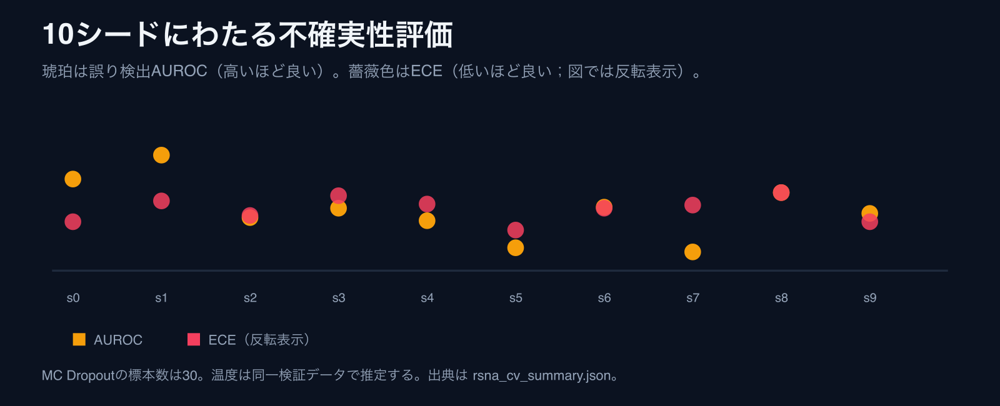</p>

## 数値の解釈

<p align="center">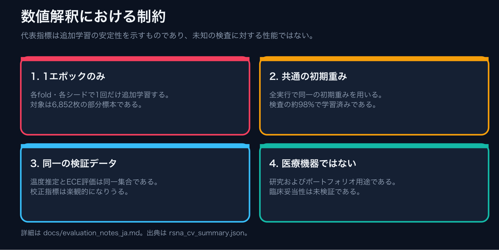</p>

<p align="center">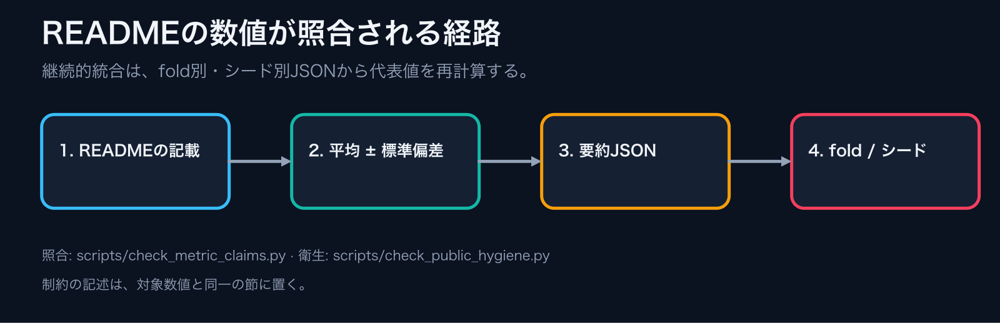</p>

## リポジトリ

<p align="center">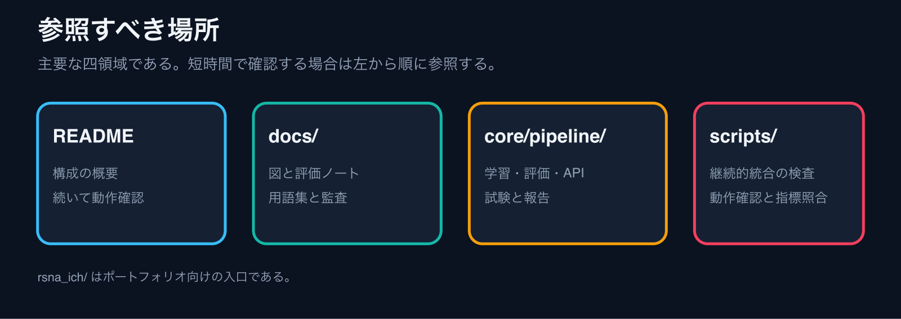</p>

<p align="center">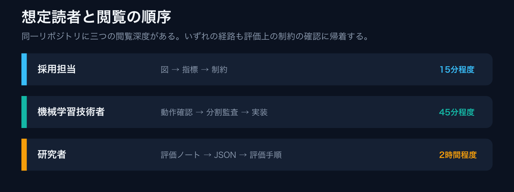</p>

<p align="center">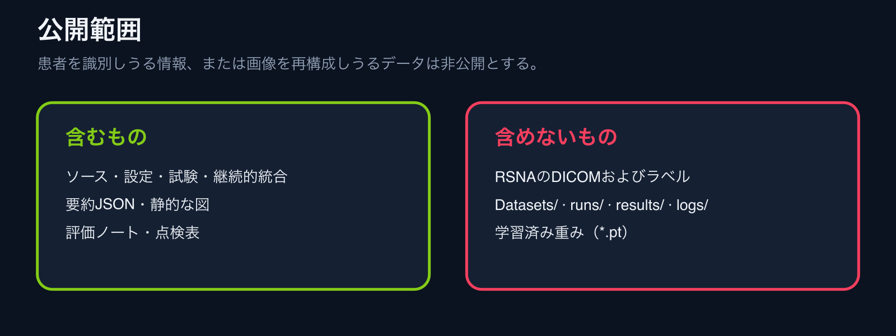</p>

## 図の再生成

```bash
python docs/assets/generate_figures.py
```

指標カードは `core/pipeline/reports/rsna_cv_summary.json` から埋め込む。患者画像は用いない。日本語文書では `assets/*_ja.png` を用いる。
