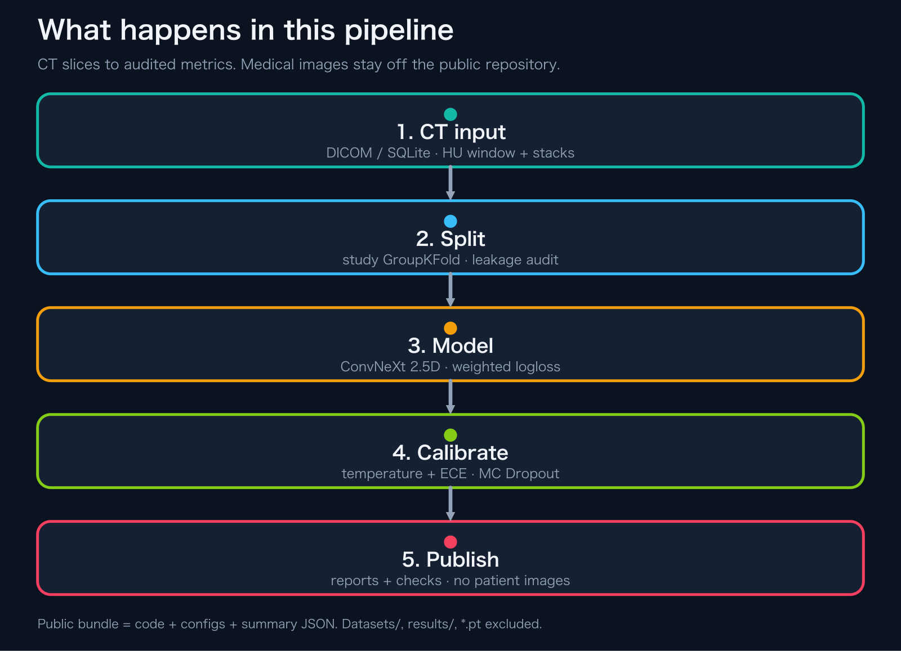
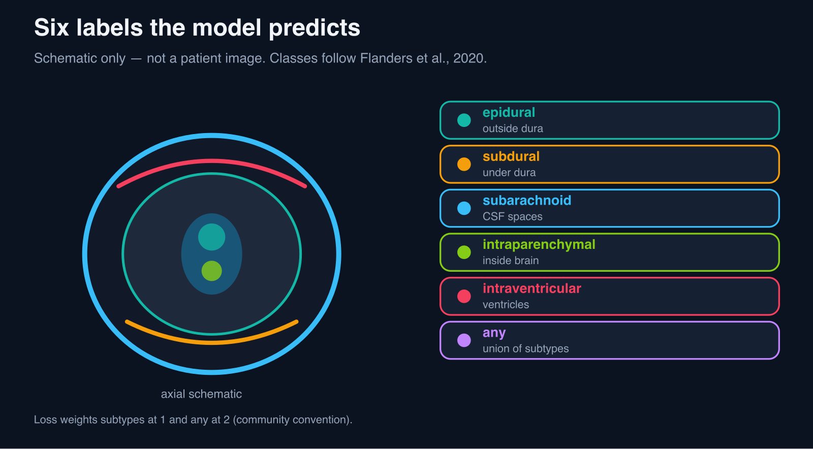
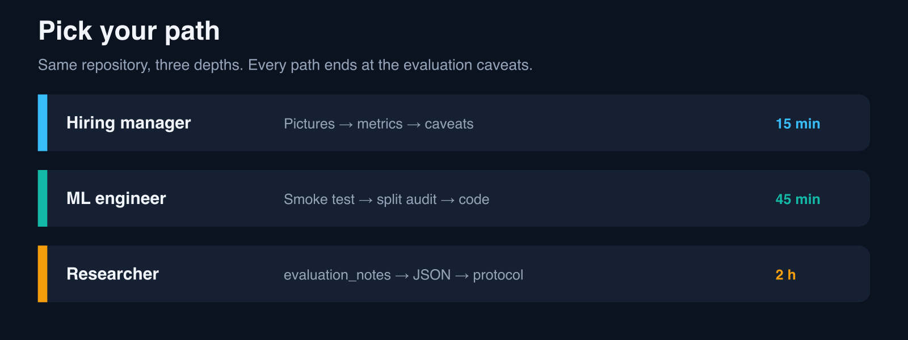
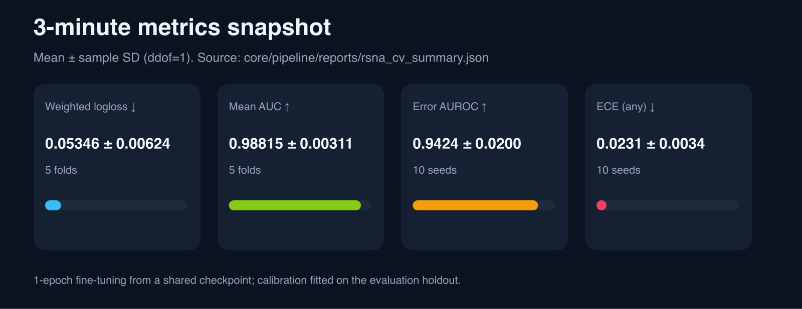
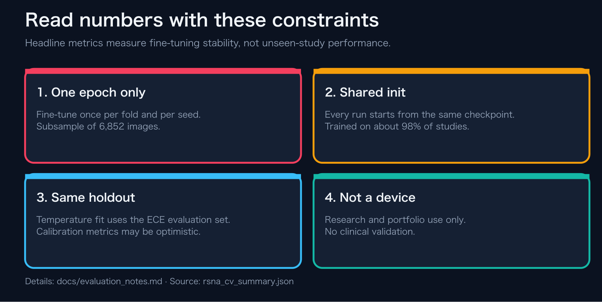
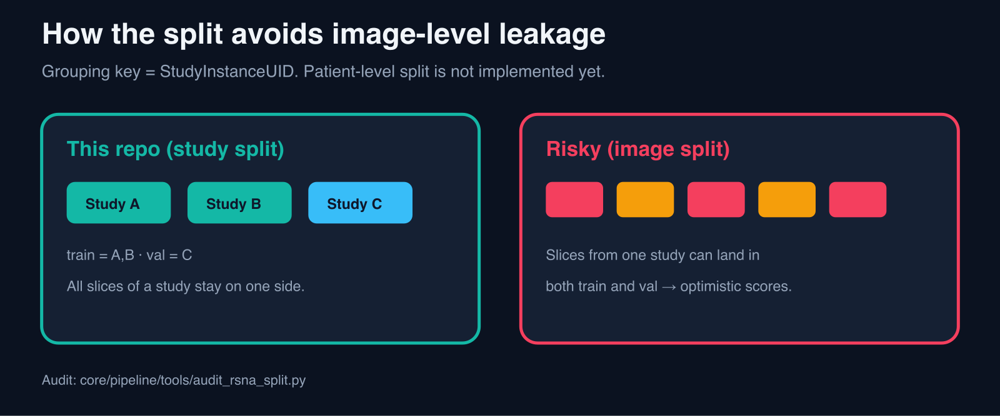
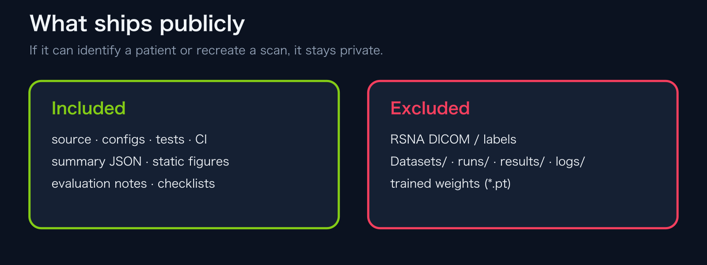

# RSNA 頭蓋内出血の分類（Kaggle 2019）

**言語:** 日本語 | [英語版](README_en.md)

本フォルダは、**RSNA ICH分類パイプライン公開版の概要**である。文章に先立ち、図による概観を示す。

## 概観

ルートの図中心README：[../README_ja.md](../README_ja.md)

## 成果の要点

表記は「平均 ± 標本標準偏差（ddof=1）」とする。元の値は [`../core/pipeline/reports/rsna_cv_summary.json`](../core/pipeline/reports/rsna_cv_summary.json) に収録する。

- 加重マルチラベル対数損失: **0.05346 ± 0.00624**（5 fold）
- 平均AUC: **0.98815 ± 0.00311**（5 fold）
- 誤り検出AUROC（`any`）: **0.9424 ± 0.0200**（10シード）
- ECE（`any`）: **0.0231 ± 0.0034**（10シード）

評価条件は次のとおりである。

- 各foldと各シードは、`limit_images=8000` で抽出したデータ（交差検証では、前処理済みデータにない画像を除いた6,852枚）で1エポックだけ追加学習している。
- 初期重みは、同じ前処理済みの学習データの98%の検査（645,793スライスのうち632,808スライス）で学習済みである。数値は追加学習の安定性を示すものであり、未知の検査に対する性能ではない。
- 温度スケーリングはECEの評価と同じ検証データで推定しているため、校正指標は楽観的に偏りうる。
- 研究およびポートフォリオのための実装であり、医療機器ではありません。

詳細は [評価ノート](../docs/evaluation_notes_ja.md) を参照する。

## 本公開物の要点

- `split_by=study` のグループ分割および監査スクリプト
- 分割前のテンソルハッシュで重複を除き、リークを抑制する
- `meta.json` / `log.jsonl` / `split_stats` による再現性監査
- `subset_fingerprint_sha256` による対象集合の同一性確認

## 参照リンク

| 用途 | 場所 |
|---|---|
| 最短の動作確認 | `python ../scripts/smoke_test.py --use_dummy_data` |
| 詳細（日本語） | [../core/pipeline/README.md](../core/pipeline/README.md) |
| 詳細（英語） | [../core/pipeline/README_en.md](../core/pipeline/README_en.md) |
| 監査ショートガイド | [./AUDIT_GUIDE.md](./AUDIT_GUIDE.md) |
| APIデモ | [../docs/api_demo_ja.md](../docs/api_demo_ja.md) |
| 引用 | [../CITATION.cff](../CITATION.cff) |
| リリースノート | [../docs/releases/v0.6.0-rsna_ja.md](../docs/releases/v0.6.0-rsna_ja.md) |
| ロードマップ | [../ROADMAP.md](../ROADMAP.md) |

## MLflow 追跡スキーマ

`--mlflow` を有効にした場合、本公開リポジトリでは3本のポートフォリオ用リポジトリで共通の追跡スキーマを用いる。

- 共通のrun tag: `repo_name`, `task_type`, `model_family`, `tracking_schema=public_portfolio_v1`
- 共通のartifactグループ:
  - `run_metadata/`: `meta.json` および、存在する場合は設定スナップショットやタスク固有のJSON
  - `training_trace/`: `log.jsonl`
  - `checkpoints/`: `last.pt`, `best.pt`, およびタスク固有のbest系チェックポイント
- 目的: セグメンテーション系と分類系のrunを同じ観点で追跡できるようにしつつ、本番向けMLOps基盤の完成を主張しないこと

## 現行のポートフォリオ用スナップショット

現行のポートフォリオ用スナップショットは、次のタグに対応する。

✅ `v0.6.0-rsna`

リポジトリは継続的に開発中である。

本公開フォルダには `Datasets/`, `runs/`, `results/` を同梱しない。実データでの再現コマンドは上記の詳細READMEを参照する。
